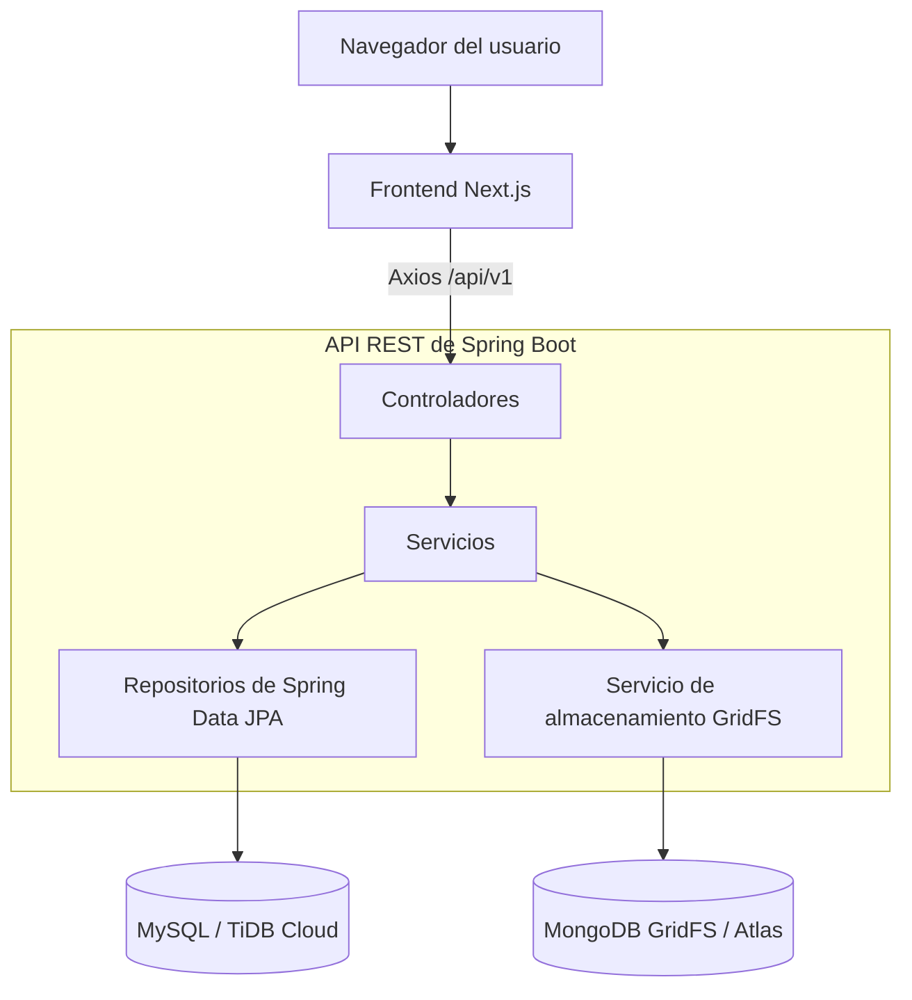

# Help Desk — Gestión de servicios de TI

**[English](./README.md) | Español**

Aplicación full stack de **gestión de servicios de TI (ITSM)** para gestionar solicitudes de soporte, hacer seguimiento de la actividad de los tickets y organizar el trabajo del servicio de asistencia.

El proyecto está desarrollado con **Java, Spring Boot, Next.js, TypeScript, MySQL y MongoDB**. Abarca el desarrollo de software de extremo a extremo, la gestión segura de sesiones, la autorización por roles, el diseño de una API REST, la persistencia híbrida, las pruebas automatizadas y el despliegue local reproducible con Docker Compose.

## Funcionalidades

- **Autenticación y autorización.** Tokens de acceso JWT, rotación de tokens de renovación en cookies HttpOnly, renovación automática de la sesión, hash de contraseñas con BCrypt y control de acceso por roles.
- **Gestión de tickets.** Creación, edición, asignación, priorización y seguimiento de las solicitudes de soporte durante todo su ciclo de vida.
- **Búsqueda y filtros.** Paginación, ordenación y filtros dinámicos en el servidor.
- **Comentarios e historial de actividad.** Comentarios públicos e internos, con un registro cronológico de los cambios de cada ticket.
- **Archivos adjuntos.** Subida, descarga y vista previa de archivos PDF, JPEG y PNG adjuntos a tickets y comentarios, almacenados en GridFS.
- **Perfiles de usuario.** Edición de datos personales, cambio de contraseña y subida, sustitución o eliminación de la foto de perfil según los permisos de la cuenta. Los cambios de avatar se reflejan en la cabecera sin recargar la página. `admin_demo`, `technician_demo` y `user_demo` pueden subir, reemplazar y eliminar su propio avatar. Sus datos personales son de solo lectura y el cambio de contraseña está deshabilitado.
- **Panel de control.** Estadísticas y tickets recientes según el rol, con acciones rápidas para administradores y técnicos.
- **Administración.** Gestión de usuarios, departamentos, categorías, prioridades y estados, y consulta de los roles configurados.
- **Internacionalización.** Interfaz en inglés y español con selector de idioma.
- **Desarrollo y entrega.** Entornos separados con Docker Compose, recarga automática en desarrollo y construcción en varias etapas de las imágenes de la aplicación compilada.
- **Controles de calidad.** Pruebas automatizadas del backend y del frontend, análisis estático y comprobaciones de compilación.

## Tecnologías

| Capa                                  | Tecnologías                                                                                                        |
| ------------------------------------- | ------------------------------------------------------------------------------------------------------------------ |
| Frontend                              | Next.js 16 (App Router), React 19, TypeScript 5                                                                    |
| Interfaz                              | Material UI, MUI X Data Grid                                                                                       |
| Cliente de API e internacionalización | Axios, next-intl                                                                                                   |
| Backend                               | Java 17, Spring Boot 4.1.1, Spring MVC, Spring Security                                                            |
| Autenticación                         | Tokens de acceso JWT (HS256), hash de contraseñas con BCrypt, rotación de tokens de renovación en cookies HttpOnly |
| Persistencia relacional               | MySQL 8.4 (local), TiDB Cloud (alojado), Spring Data JPA, Hibernate                                                |
| Almacenamiento de archivos            | MongoDB 8.0 (local), MongoDB Atlas (en la nube), Spring Data MongoDB, GridFS                                       |
| Infraestructura local                 | Docker, Docker Compose, Compose Watch                                                                              |
| Despliegue en la nube                 | Vercel (frontend), Render (backend)                                                                                |
| Pruebas                               | JUnit Jupiter 6, Mockito, Spring MockMvc, Vitest, React Testing Library                                            |
| Herramientas                          | Maven, npm, ESLint, Git                                                                                            |

## Arquitectura



La API REST bajo `/api/v1` utiliza una arquitectura por capas. Los controladores definen los endpoints HTTP y validan los DTO de las peticiones. Los servicios aplican las reglas de negocio y coordinan la persistencia mediante los repositorios de Spring Data y el servicio de almacenamiento GridFS. Un gestor centralizado de excepciones convierte los errores en respuestas HTTP. Las especificaciones de JPA construyen consultas dinámicas de tickets.

### Autenticación y autorización

Spring Security valida las credenciales de inicio de sesión mediante los hashes de contraseña de BCrypt. Al iniciar sesión, el servidor devuelve un token de acceso JWT de corta duración y establece una cookie `HttpOnly` con el token de renovación. El frontend guarda el token de acceso en `localStorage` y lo envía como token Bearer en las peticiones protegidas a la API.

Cuando una petición protegida devuelve `401`, Axios puede renovar la sesión a través del endpoint de renovación y reintentar la petición una vez. El backend valida el token de renovación, lo revoca y entrega un nuevo token de renovación en la cookie junto con un nuevo token de acceso en la respuesta. La base de datos relacional almacena los hashes de los tokens de renovación.

El frontend adapta la navegación y las acciones disponibles según el rol. Spring Security y los servicios del backend aplican los permisos de acceso a los endpoints y recursos.

### Persistencia híbrida

**MySQL / TiDB Cloud** almacena usuarios y roles, departamentos, categorías, prioridades, estados, tickets, comentarios, historial de tickets, hashes de tokens de renovación y metadatos de archivos y avatares.

**MongoDB / MongoDB Atlas** almacena los archivos binarios de los adjuntos de tickets, los adjuntos de comentarios y los avatares de usuario en buckets separados de GridFS.

| Funcionalidad                      | Tabla SQL de metadatos       | Bucket de MongoDB GridFS |
| ---------------------------------- | ---------------------------- | ------------------------ |
| Adjuntos de tickets                | `ticket_attachments`         | `ticket_files`           |
| Adjuntos de comentarios de tickets | `ticket_comment_attachments` | `ticket_comment_files`   |
| Avatares de usuario                | `user_avatars`               | `user_avatars`           |

Cada fila de metadatos SQL almacena un `mongo_file_id` que apunta al archivo correspondiente de GridFS. El backend valida el tamaño y la firma de los archivos subidos. Las escrituras en SQL y GridFS son operaciones separadas. El backend intenta limpiar los archivos de GridFS cuando falla la escritura de metadatos y al reemplazar o eliminar avatares.

### Arquitectura en la nube

Vercel aloja el frontend de Next.js y Render aloja la API de Spring Boot. TiDB Cloud almacena los datos relacionales y MongoDB Atlas aloja los buckets de GridFS.

En Vercel, `NEXT_PUBLIC_API_BASE_URL=/api/v1` hace que el navegador envíe las peticiones de la API al origen del frontend. `BACKEND_PROXY_URL` indica el origen del backend en Render. Las reglas de reescritura de `next.config.ts` reenvían `/api/v1/:path*` a la misma ruta en ese origen.

En Docker local, el navegador se conecta directamente al puerto publicado de Spring Boot. El frontend construye la URL de la API a partir de `NEXT_PUBLIC_WEB_SERVER` y `NEXT_PUBLIC_WEB_PORT_BACK_END`, con el prefijo `/api/v1`.

## Roles de usuario

Los roles determinan los permisos generales de la aplicación.

| Rol            | Permisos principales                                                                                                                                                                           |
| -------------- | ---------------------------------------------------------------------------------------------------------------------------------------------------------------------------------------------- |
| **ADMIN**      | Gestionar todos los tickets, usuarios y catálogos de configuración, y consultar las estadísticas generales.                                                                                    |
| **TECHNICIAN** | Consultar los tickets asignados al usuario y los tickets sin asignar, actualizar tickets y añadir comentarios internos cuando tenga permiso, y consultar las estadísticas de sus asignaciones. |
| **USER**       | Crear solicitudes de soporte, hacer seguimiento de los tickets que ha creado o que se han solicitado para él, y añadir comentarios públicos.                                                   |

Los administradores pueden consultar los roles predefinidos en un catálogo de solo lectura.

La cuenta privada `admin` conserva los permisos habituales de `ADMIN`. `admin_demo` puede gestionar las cuentas `USER` y `TECHNICIAN` no protegidas. Spring Boot impide que `admin_demo` edite las cuatro cuentas protegidas o conceda `ADMIN`. Consulta [Cuentas de demostración](#cuentas-de-demostración) para conocer los nombres de usuario protegidos y las restricciones del perfil.

## Puesta en marcha con Docker

Docker ejecuta toda la aplicación Help Desk en local. Las imágenes de los contenedores proporcionan Java, Node.js, MySQL y MongoDB.

### Requisitos

- Docker Desktop en ejecución o Docker Engine con el complemento Docker Compose.
- Docker Compose 2.32.0 o posterior para DEV, que utiliza la acción `restart` de Compose Watch. Consulta la versión instalada con `docker compose version`. [Especificación de Compose Develop](https://docs.docker.com/reference/compose-file/develop/#action)
- Puertos libres en el equipo para el entorno que quieras ejecutar. Solo el frontend y el backend publican puertos en el equipo anfitrión.

| Entorno      | Puerto del frontend | Puerto del backend |
| ------------ | ------------------- | ------------------ |
| PROD (local) | `3000`              | `8080`             |
| DEV          | `3001`              | `8081`             |

Ejecuta los comandos de este apartado desde la raíz del repositorio.

### Archivos de entorno

Para una instalación nueva, copia el archivo de ejemplo del entorno que vayas a ejecutar.

```powershell
# Windows PowerShell
Copy-Item .env.sample .env
Copy-Item .env.dev.sample .env.dev
```

```bash
# Linux / macOS
cp .env.sample .env
cp .env.dev.sample .env.dev
```

Sustituye las contraseñas y claves JWT de ejemplo antes de arrancar la aplicación. Mantén `.env`, `.env.dev` y las credenciales privadas fuera del control de versiones y de GitHub.

| PROD (`.env`)                   | DEV (`.env.dev`)                    | Uso y valores en local                                                                                           |
| ------------------------------- | ----------------------------------- | ---------------------------------------------------------------------------------------------------------------- |
| `MYSQL_ROOT_PASSWORD`           | `DEV_MYSQL_ROOT_PASSWORD`           | Contraseña de la cuenta root de MySQL.                                                                           |
| `DB_USERNAME`                   | `DEV_DB_USERNAME`                   | Cuenta de MySQL que utiliza Spring Boot. Los ejemplos usan `helpdesk`.                                           |
| `DB_PASSWORD`                   | `DEV_DB_PASSWORD`                   | Contraseña de la cuenta de MySQL que utiliza la aplicación.                                                      |
| `JWT_SECRET`                    | `DEV_JWT_SECRET`                    | Clave de firma de JWT codificada en Base64.                                                                      |
| `FRONTEND_URL`                  | `DEV_FRONTEND_URL`                  | Origen del navegador permitido por la API. Usa `http://localhost:3000` en PROD y `http://localhost:3001` en DEV. |
| `NEXT_PUBLIC_WEB_SERVER`        | `DEV_NEXT_PUBLIC_WEB_SERVER`        | Nombre de host del backend que utiliza el navegador. Usa `localhost` en ambos entornos.                          |
| `NEXT_PUBLIC_WEB_PORT_BACK_END` | `DEV_NEXT_PUBLIC_WEB_PORT_BACK_END` | Puerto publicado del backend que utiliza el navegador. Usa `8080` en PROD y `8081` en DEV.                       |

### Clave de firma de JWT

Spring Boot decodifica la clave desde Base64 y la utiliza con HS256. Genera una clave distinta para cada entorno a partir de al menos 32 bytes aleatorios criptográficamente seguros antes de codificarla en Base64. Guarda la cadena resultante en `JWT_SECRET` o `DEV_JWT_SECRET`.

```powershell
# Windows PowerShell
$key = New-Object byte[] 32
$rng = [System.Security.Cryptography.RandomNumberGenerator]::Create()
try {
    $rng.GetBytes($key)
    [Convert]::ToBase64String($key)
} finally {
    $rng.Dispose()
}
```

```bash
# Linux / macOS with OpenSSL
openssl rand -base64 32
```

### Inicialización de MySQL

Ambos archivos de Compose montan `database/` en `/docker-entrypoint-initdb.d` en modo de solo lectura. MySQL ejecuta los archivos SQL ubicados directamente en `database/` por orden de nombre al inicializar por primera vez un volumen vacío.

1. `01_create_tables.sql` crea las tablas y sus relaciones.
2. `02_seed_reference_data.sql` carga los catálogos de referencia.
3. `03_seed_admin.sql` inicializa el administrador privado cuando el propietario ha preparado ese archivo en local.
4. `04_seed_demo_data.sql` carga las cuentas de demostración, los tickets de ejemplo, los comentarios y el historial.

`database/.gitignore` excluye de Git el archivo de inicialización del administrador privado. En un clon nuevo, utiliza las cuentas públicas de demostración que se indican más abajo. Para crear el administrador privado durante la instalación inicial, el archivo local del propietario debe estar presente antes de que MySQL se inicialice.

`database/local/00_setup_local_database.sql` se utiliza para la instalación manual sin Docker. Cuando MySQL reutiliza un volumen ya inicializado, omite los scripts de inicialización.

### Opción 1 — Ejecutar la aplicación compilada (recomendada para demostraciones)

PROD es la compilación local en modo producción. Una vez configurado `.env`, valida la configuración de Compose e inicia la aplicación.

```bash
docker compose config --quiet
docker compose up -d --build
```

La compilación empaqueta el backend y el frontend en imágenes. A continuación, Compose inicia los contenedores de la aplicación, MySQL y MongoDB en segundo plano. El backend arranca cuando ambas bases de datos superan sus comprobaciones de estado.

- Frontend <http://localhost:3000>
- API REST `http://localhost:8080/api/v1`

### Opción 2 — Desarrollo con recarga automática

Una vez configurado `.env.dev`, inicia los servicios de desarrollo.

```bash
docker compose --env-file .env.dev -f docker-compose.dev.yaml config --quiet
docker compose --env-file .env.dev -f docker-compose.dev.yaml up -d --build
```

Ejecuta Compose Watch en una segunda terminal durante el desarrollo.

```bash
docker compose --env-file .env.dev -f docker-compose.dev.yaml watch --no-up backend
```

Compose Watch reinicia el contenedor del backend cuando cambia `back-end/src` o `back-end/pom.xml`. Maven vuelve a compilar al reiniciar. Next.js recarga el frontend durante el desarrollo mediante Webpack y comprobaciones periódicas de cambios.

- Frontend <http://localhost:3001>
- API REST `http://localhost:8081/api/v1`

### Comprobar y detener servicios

Utiliza `ps` para consultar los contenedores en ejecución y `logs` para revisar la salida reciente. Con `stop` puedes detener los servicios y conservar sus datos.

```bash
# PROD (local)
docker compose ps
docker compose logs --tail=100 backend
docker compose logs --tail=100 mysql
docker compose stop
```

```bash
# DEV
docker compose --env-file .env.dev -f docker-compose.dev.yaml ps
docker compose --env-file .env.dev -f docker-compose.dev.yaml logs --tail=100 backend
docker compose --env-file .env.dev -f docker-compose.dev.yaml logs --tail=100 mysql
docker compose --env-file .env.dev -f docker-compose.dev.yaml stop
```

### Persistencia de datos

DEV y PROD utilizan volúmenes con nombre independientes para MySQL y MongoDB. Al detener los servicios se conservan los contenedores y sus volúmenes. Al recrear los contenedores, se reemplazan y se vuelven a montar sus volúmenes con nombre, que conservan los datos.

**`docker compose down -v` elimina los volúmenes declarados del proyecto seleccionado y los datos de MySQL y MongoDB que contienen.**

Para consultar cómo reconstruir las imágenes, resolver problemas y trabajar en el día a día, consulta el [Flujo de trabajo con Docker](./DOCKER-WORKFLOW.md).

### Cuentas de demostración

Los datos de inicialización incluyen tres cuentas públicas de demostración para explorar los roles de la aplicación.

| Usuario           | Contraseña                | Rol        |
| ----------------- | ------------------------- | ---------- |
| `admin_demo`      | `admin_demo12345678`      | ADMIN      |
| `technician_demo` | `technician_demo12345678` | TECHNICIAN |
| `user_demo`       | `user_demo12345678`       | USER       |

Spring Boot aplica las restricciones de cuenta en el servidor.

- `admin_demo` puede consultar a todos los usuarios y editar las cuentas de usuarios normales y técnicos. En el módulo de usuarios, las cuentas `admin`, `admin_demo`, `technician_demo` y `user_demo` son de solo lectura para `admin_demo`. Spring Boot impide que `admin_demo` conceda el rol `ADMIN`.
- `technician_demo` y `user_demo` pueden utilizar las funciones disponibles para sus respectivos roles.
- Las tres cuentas de demostración tienen los datos personales en modo de solo lectura y el cambio de contraseña deshabilitado. Pueden subir, reemplazar o eliminar su propio avatar. Al eliminarlo, se muestra el avatar predeterminado tanto en el perfil como en la cabecera sin recargar la página.
- Los visitantes pueden iniciar sesión como `admin_demo` para crear más cuentas de prueba con los roles `USER` o `TECHNICIAN` y probar las operaciones permitidas de gestión de usuarios.
- `admin` es la cuenta de administrador privada.

Mantén `.env`, `.env.dev` y las credenciales reales fuera de Git. En este repositorio, PROD es una **compilación en modo producción para ejecución local**. Un despliegue público requiere medidas de seguridad adicionales.

## Instalación manual (sin Docker)

Instala JDK 17, Node.js 22 (22.22.2 o posterior dentro de la serie 22.x para usar las versiones de dependencias fijadas), npm, MySQL 8 y MongoDB 8. Maven Wrapper está incluido en `back-end/`.

### Preparar MySQL y MongoDB

Arranca ambos servidores de bases de datos. Desde un cliente de MySQL conectado como administrador, ejecuta `database/local/00_setup_local_database.sql` para crear la base de datos `helpdesk`. Crea o selecciona una cuenta de MySQL dedicada con acceso de lectura y escritura a `helpdesk` para Spring Boot.

Inicializa la base de datos nueva ejecutando los siguientes archivos en orden.

1. `database/01_create_tables.sql` crea el esquema y las relaciones.
2. `database/02_seed_reference_data.sql` carga los catálogos de referencia.
3. `database/03_seed_admin.sql` crea el administrador privado cuando el propietario ha preparado en local ese archivo excluido de Git.
4. `database/04_seed_demo_data.sql` carga las cuentas públicas de demostración y los datos de tickets de ejemplo.

Completa la inicialización de MySQL antes de iniciar Spring Boot. Hibernate utiliza `spring.jpa.hibernate.ddl-auto=validate` y necesita que el esquema ya exista. MongoDB almacena archivos binarios en la base de datos `helpdesk_attachments` mediante GridFS. El backend crea las colecciones de GridFS cuando las necesita. Los scripts SQL se aplican solo a MySQL. Consulta el [README de la base de datos](./database/README.md).

### Configurar y ejecutar Spring Boot

Define estas variables de entorno en la terminal que vaya a iniciar Spring Boot o en la configuración de ejecución de tu IDE.

```dotenv
DB_URL=jdbc:mysql://localhost:3306/helpdesk
DB_USERNAME=replace_with_local_mysql_username
DB_PASSWORD=replace_with_local_mysql_password
JWT_SECRET=replace_with_generated_base64_key
FRONTEND_URL=http://localhost:3000
MONGODB_URI=mongodb://localhost:27017/helpdesk_attachments
```

En PowerShell, utiliza `$env:NAME = 'value'` para cada variable. En Linux o macOS, utiliza `export NAME='value'`. Usa las credenciales de tu cuenta de MySQL y genera `JWT_SECRET` con los [ejemplos de generación de claves JWT](#clave-de-firma-de-jwt). Mantén las credenciales y las claves de firma fuera del control de versiones.

Ejecuta Maven Wrapper desde `back-end/`.

```powershell
# Windows PowerShell
.\mvnw.cmd spring-boot:run
```

```bash
# Linux / macOS
chmod u+x mvnw
./mvnw spring-boot:run
```

Spring Boot usa por defecto el puerto `8080` y sirve la API bajo `/api/v1`. Consulta el [README del backend](./back-end/README.md) para ver opciones adicionales de configuración.

### Configurar y ejecutar Next.js

Desde `front-end/`, copia `.env.sample` a `.env` con `Copy-Item .env.sample .env` en PowerShell o `cp .env.sample .env` en Linux o macOS. Establece estos valores en `front-end/.env`.

```dotenv
NEXT_PUBLIC_WEB_SERVER=localhost
NEXT_PUBLIC_WEB_PORT_BACK_END=8080
```

Deja sin definir `NEXT_PUBLIC_API_BASE_URL`, la variable del proxy de Vercel, para esta instalación. Con los valores locales, Next.js envía las peticiones del navegador a `http://localhost:8080/api/v1`.

```bash
npm ci
npm run dev
```

Abre <http://localhost:3000>. Consulta el [README del frontend](./front-end/README.md) para más detalles.

### Verificar la instalación local

1. Conéctate a `helpdesk` con la cuenta de MySQL de la aplicación y ejecuta `SHOW TABLES;`. Comprueba MongoDB con `db.runCommand({ ping: 1 })` en la consola de MongoDB.
2. Revisa los logs de arranque de Spring Boot para detectar errores de conexión o de validación del esquema.
3. Abre el frontend e inicia sesión con una [cuenta de demostración](#cuentas-de-demostración) si has cargado los datos de ejemplo. En la pestaña Red del navegador, comprueba que `POST http://localhost:8080/api/v1/auth/login` responde correctamente.

## Pruebas y controles de calidad

### Pruebas del backend

El backend utiliza **JUnit Jupiter 6** y **Mockito** para las pruebas de controladores y servicios. Las pruebas cubren la autenticación, los usuarios, los tickets, los comentarios, el historial y los catálogos de configuración. Algunas pruebas de autorización usan Spring MockMvc con dependencias simuladas para comprobar el acceso a los recursos de tickets y las restricciones sobre las cuentas protegidas, la concesión del rol ADMIN y los cambios en los perfiles de demostración.

Ejecuta Maven Wrapper desde `back-end/`. En Linux o macOS, concede permiso de ejecución al script tal como se indica en la [instalación manual](#instalación-manual-sin-docker).

```powershell
# Windows PowerShell
.\mvnw.cmd clean verify
```

```bash
# Linux / macOS
./mvnw clean verify
```

Maven elimina los resultados de compilaciones anteriores, compila el código de la aplicación y de las pruebas, ejecuta las pruebas configuradas y empaqueta la aplicación como parte del ciclo que llega hasta la fase `verify`.

### Pruebas del frontend

El frontend utiliza **Vitest** y **React Testing Library** para probar las llamadas a los servicios de la API, la renovación de tokens mediante Axios y componentes concretos como formularios y diálogos de tickets.

Desde `front-end/`, ejecuta el conjunto de pruebas una vez con `npm run test:run`. Usa `npm test` para ejecutar Vitest en modo interactivo con detección de cambios mientras editas las pruebas.

### Controles de calidad del frontend

- `npm run lint` ejecuta ESLint con las reglas de análisis estático configuradas.
- `npm run build` comprueba que Next.js puede compilar y generar la versión de producción.

Ejecuta también las pruebas funcionales para comprobar el comportamiento. Antes de integrar cambios importantes en el frontend, configura las variables de la API como se describe en la [instalación manual](#instalación-manual-sin-docker) y comprueba que la verificación completa termine correctamente desde `front-end/`.

```bash
npm ci
npm run check
```

`npm ci` instala las dependencias a partir del archivo de bloqueo de versiones. `npm run check` ejecuta ESLint, Vitest una vez y la compilación de producción de Next.js, en ese orden. Se detiene si falla algún paso.

### Comprobaciones de integración

Complementa las pruebas automatizadas con comprobaciones sobre la aplicación en ejecución. Verifica la autenticación y la autorización mediante la API en funcionamiento, la conexión de Spring Boot con MySQL, la subida y recuperación de archivos con MongoDB GridFS y las peticiones de extremo a extremo entre Next.js y Spring Boot.

## Estructura del repositorio

```text
IT-Service-Management/
├── back-end/                 # API REST de Spring Boot y pruebas del backend
│   ├── Dockerfile
│   ├── Dockerfile.dev
│   └── README.md
├── front-end/                # Aplicación Next.js y pruebas del frontend
│   ├── Dockerfile
│   ├── Dockerfile.dev
│   └── README.md
├── database/                 # Esquema de MySQL y datos de demostración
│   ├── local/
│   │   └── 00_setup_local_database.sql
│   ├── 01_create_tables.sql
│   ├── 02_seed_reference_data.sql
│   ├── 03_seed_admin.sql      # Archivo privado local que prepara el propietario y que Git ignora
│   ├── 04_seed_demo_data.sql
│   └── README.md
├── docker-compose.yaml
├── docker-compose.dev.yaml
├── .env.sample
├── .env.dev.sample
├── DOCKER-WORKFLOW.md
├── GIT_WORKFLOW.md
├── LICENSE
└── README.md
```

- `local/00_setup_local_database.sql` crea la base de datos local `helpdesk` para la instalación manual.
- `01_create_tables.sql` crea las tablas y sus relaciones.
- `02_seed_reference_data.sql` carga la configuración inicial, incluidos los roles, departamentos, categorías, prioridades y estados.
- `03_seed_admin.sql` crea el administrador privado. El propietario prepara este archivo localmente después de clonar el repositorio y `database/.gitignore` lo excluye de Git.
- `04_seed_demo_data.sql` añade las cuentas de demostración, los tickets de ejemplo, los comentarios y el historial de tickets.

Los scripts se ejecutan en el orden `01`, `02`, `03` si está presente el archivo privado de inicialización y, por último, `04`. Docker ejecuta solo los scripts SQL ubicados directamente en `database/` cuando MySQL inicializa un volumen vacío por primera vez. MySQL omite la inicialización cuando reutiliza un volumen existente.

## Documentación del proyecto

| Documento                                           | Contenido                                                                       |
| --------------------------------------------------- | ------------------------------------------------------------------------------- |
| [Backend](./back-end/README.md)                     | Arquitectura de la API, seguridad, configuración, endpoints y pruebas           |
| [Frontend](./front-end/README.md)                   | Arquitectura de la interfaz, configuración del entorno, autenticación y pruebas |
| [Base de datos](./database/README.md)               | Esquema de MySQL, inicialización y datos de demostración                        |
| [Flujo de trabajo con Docker](./DOCKER-WORKFLOW.md) | Entornos Docker, comandos y flujo de desarrollo                                 |
| [Flujo de trabajo con Git](./GIT_WORKFLOW.md)       | Ramas, commits, pull requests y pautas de colaboración                          |

## Licencia

Copyright © 2026 Diego González Sanz. Todos los derechos reservados.

Este proyecto es **de código propietario** y se publica como parte del portafolio para su consulta y evaluación. La reutilización, modificación y redistribución requieren autorización previa por escrito. Consulta [LICENSE](./LICENSE) para conocer los términos completos.
