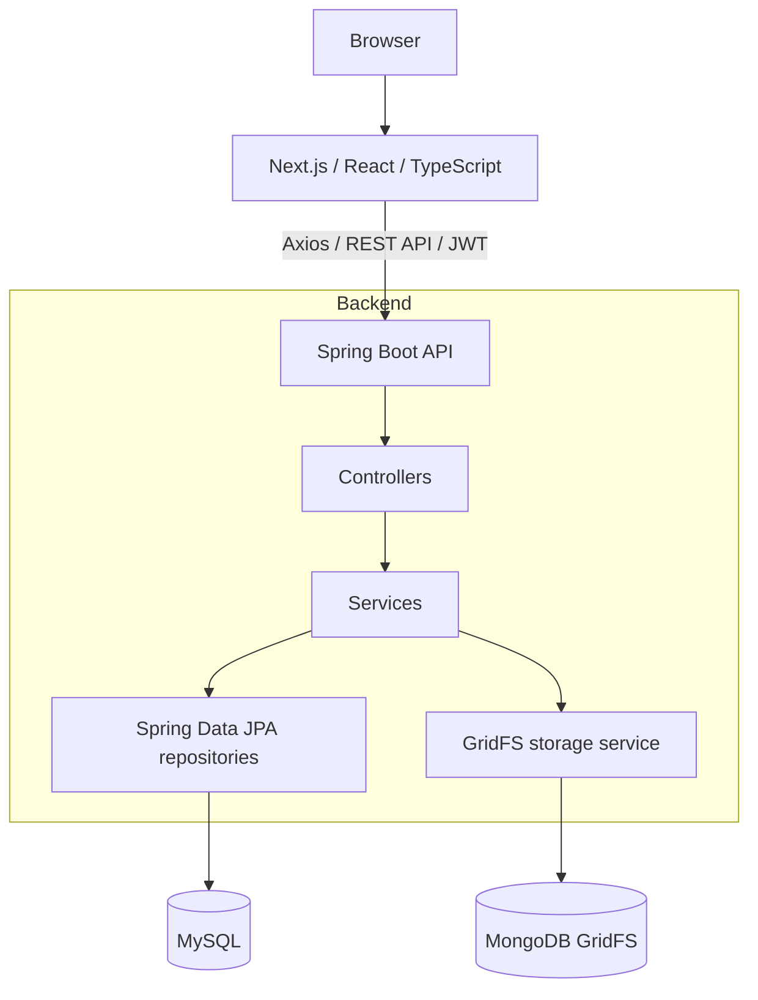

# Help Desk — IT Service Management

A full-stack **IT Service Management (ITSM)** application for managing IT support requests, tracking ticket activity, and organizing service desk operations.

Built with **Java, Spring Boot, Next.js, TypeScript, MySQL, and MongoDB**, the project demonstrates end-to-end software development, secure session management, role-based authorization, REST API design, hybrid data persistence, automated testing, and reproducible local deployment with Docker Compose.

## Features

- **Authentication and authorization:** JWT access tokens, rotating refresh tokens in HttpOnly cookies, automatic session renewal, BCrypt password hashing, and role-based access control.
- **Ticket management:** Create, update, assign, prioritize, and track support requests throughout their lifecycle.
- **Search and filtering:** Server-side pagination, sorting, and dynamic filters.
- **Comments and activity history:** Public and internal comments, with chronological tracking of ticket changes.
- **File attachments:** Upload, download, and preview PDF and image files associated with tickets or ticket comments.
- **User profiles:** Edit personal information, change passwords, and upload, replace, or remove profile pictures. Avatar changes are reflected in the application header without reloading the page.
- **Dashboard:** Role-specific statistics, recent tickets, and shortcuts.
- **Administration:** Manage users, departments, categories, priorities, and statuses, and view configured roles.
- **Internationalization:** English and Spanish interfaces with language selection.
- **Development and delivery:** Separate Docker Compose environments, automatic development reloads, and multi-stage builds for compiled application images.
- **Quality checks:** Backend and frontend automated tests, linting, and build checks.

## Tech Stack

| Layer                  | Technologies                                            |
| ---------------------- | ------------------------------------------------------- |
| Frontend               | Next.js 16 (App Router), React 19, TypeScript           |
| UI                     | Material UI, MUI X Data Grid                            |
| API client / i18n      | Axios, next-intl                                        |
| Backend                | Java 17, Spring Boot 4.1.1, Spring MVC, Spring Security |
| Authentication         | JWT (HS256), BCrypt, HttpOnly refresh-token cookies     |
| Relational persistence | MySQL 8.4, Spring Data JPA, Hibernate                   |
| File storage           | MongoDB 8.0, Spring Data MongoDB, GridFS                |
| Testing                | JUnit 5, Mockito, Vitest, React Testing Library         |
| Infrastructure         | Docker, Docker Compose, Compose Watch                   |
| Tooling                | Maven, npm, ESLint, Git                                 |

## Architecture



The REST API (`/api/v1`) uses a layered architecture with controllers, services, repositories, DTOs, validation, centralized exception handling, and JPA specifications for dynamic ticket queries. Authentication combines short-lived JWT access tokens with rotating, server-managed refresh tokens. Authorization is enforced by the backend.

### Hybrid persistence

MySQL stores business data, relationships, and file metadata. MongoDB GridFS stores the binary file contents in three dedicated buckets:

| Functionality              | MySQL table                  | MongoDB GridFS bucket  |
| -------------------------- | ---------------------------- | ---------------------- |
| Ticket attachments         | `ticket_attachments`         | `ticket_files`         |
| Ticket comment attachments | `ticket_comment_attachments` | `ticket_comment_files` |
| User avatars               | `user_avatars`               | `user_avatars`         |

The metadata includes a reference to the corresponding GridFS file. Uploads include file-size and file-signature checks. Avatars support replacement and removal, with best-effort GridFS cleanup coordinated with MySQL transaction completion. These operations do not constitute a distributed transaction across the two databases.

## User Roles

| Role           | Main capabilities                                                                                           |
| -------------- | ----------------------------------------------------------------------------------------------------------- |
| **ADMIN**      | Manage all tickets, users, and configuration catalogs; access system-wide statistics.                       |
| **TECHNICIAN** | Work with assigned tickets, update their workflow, add internal comments, and access technician statistics. |
| **USER**       | Create and follow support requests, add public comments, and manage their own profile.                      |

Frontend role checks control navigation and available actions. The predefined roles can be viewed but not created or edited through the application.

## Getting Started with Docker

Docker runs the full Help Desk stack locally. Java, Node.js, MySQL, and MongoDB are provided by the container images.

### Requirements

- A running Docker Desktop installation or Docker Engine with the Docker Compose plugin.
- Docker Compose 2.32.0 or later for DEV, which uses the Compose Watch `restart` action. Check the installed version with `docker compose version`. [Compose Develop specification](https://docs.docker.com/reference/compose-file/develop/#action)
- Free host ports for the environment you want to run. Only the frontend and backend publish host ports.

| Environment | Frontend port | Backend port |
| ----------- | ------------- | ------------ |
| PROD (local) | `3000` | `8080` |
| DEV | `3001` | `8081` |

Run the commands below from the repository root.

### Environment files

For a new setup, copy the sample for the environment you plan to run.

```powershell
# Windows PowerShell
Copy-Item .env.sample .env
Copy-Item .env.dev.sample .env.dev
```

```bash
# Linux / macOS
cp .env.sample .env
cp .env.dev.sample .env.dev
```

Replace the placeholder passwords and JWT secrets before starting. Keep `.env`, `.env.dev`, and private credentials out of version control and off GitHub.

| PROD (`.env`) | DEV (`.env.dev`) | Purpose and local values |
| -------------- | ---------------- | ------------------------ |
| `MYSQL_ROOT_PASSWORD` | `DEV_MYSQL_ROOT_PASSWORD` | Password for the MySQL root account. |
| `DB_USERNAME` | `DEV_DB_USERNAME` | MySQL account used by Spring Boot. The samples use `helpdesk`. |
| `DB_PASSWORD` | `DEV_DB_PASSWORD` | Password for the MySQL application account. |
| `JWT_SECRET` | `DEV_JWT_SECRET` | Base64-encoded JWT signing key. |
| `FRONTEND_URL` | `DEV_FRONTEND_URL` | Browser origin allowed by the API. Use `http://localhost:3000` in PROD and `http://localhost:3001` in DEV. |
| `NEXT_PUBLIC_WEB_SERVER` | `DEV_NEXT_PUBLIC_WEB_SERVER` | Backend hostname used by the browser. Use `localhost` in both environments. |
| `NEXT_PUBLIC_WEB_PORT_BACK_END` | `DEV_NEXT_PUBLIC_WEB_PORT_BACK_END` | Published backend port used by the browser. Use `8080` in PROD and `8081` in DEV. |

### JWT signing key

Spring Boot decodes the signing key from Base64 and uses it with HS256. Generate a separate key for each environment from at least 32 cryptographically random bytes before Base64 encoding. Store the resulting string in `JWT_SECRET` or `DEV_JWT_SECRET`.

```powershell
# Windows PowerShell
$key = New-Object byte[] 32
$rng = [System.Security.Cryptography.RandomNumberGenerator]::Create()
try {
    $rng.GetBytes($key)
    [Convert]::ToBase64String($key)
} finally {
    $rng.Dispose()
}
```

```bash
# Linux / macOS with OpenSSL
openssl rand -base64 32
```

### MySQL initialization

Both Compose files mount `database/` read-only at `/docker-entrypoint-initdb.d`. MySQL executes the SQL files directly under `database/` in filename order on its first initialization with an empty volume.

1. `01_create_tables.sql` creates the tables and relationships.
2. `02_seed_reference_data.sql` loads the reference catalogs.
3. `03_seed_admin.sql` initializes the private administrator when the owner has prepared the file locally.
4. `04_seed_demo_data.sql` loads the demo accounts, sample tickets, comments, and history.

`database/.gitignore` excludes the private administrator seed from Git. On a fresh clone, use the public demo accounts below. Creating the private administrator during initial setup requires the owner's local seed to be present before MySQL initializes.

`database/local/00_setup_local_database.sql` is for manual setup outside Docker. MySQL skips the initialization scripts when it reuses an initialized volume.

### Option 1 — Run the compiled application (recommended for demonstrations)

PROD is the local production-mode build. With `.env` configured, validate the Compose configuration and start the application.

```bash
docker compose config --quiet
docker compose up -d --build
```

The build packages the backend and frontend into images. Compose then starts the application containers, MySQL, and MongoDB in the background. The backend starts after both database health checks pass.

- Frontend <http://localhost:3000>
- REST API `http://localhost:8080/api/v1`

### Option 2 — Development with live reload

With `.env.dev` configured, start the development services.

```bash
docker compose --env-file .env.dev -f docker-compose.dev.yaml config --quiet
docker compose --env-file .env.dev -f docker-compose.dev.yaml up -d --build
```

Run Compose Watch in a second terminal while developing.

```bash
docker compose --env-file .env.dev -f docker-compose.dev.yaml watch --no-up backend
```

Compose Watch restarts the running backend container when `back-end/src` or `back-end/pom.xml` changes. Maven recompiles on restart. Next.js handles frontend live reloading through Webpack and polling.

- Frontend <http://localhost:3001>
- REST API `http://localhost:8081/api/v1`

### Check and stop services

Use `ps` to check running containers and `logs` to read recent output. Use `stop` to shut down the services and retain their data.

```bash
# PROD (local)
docker compose ps
docker compose logs --tail=100 backend
docker compose logs --tail=100 mysql
docker compose stop
```

```bash
# DEV
docker compose --env-file .env.dev -f docker-compose.dev.yaml ps
docker compose --env-file .env.dev -f docker-compose.dev.yaml logs --tail=100 backend
docker compose --env-file .env.dev -f docker-compose.dev.yaml logs --tail=100 mysql
docker compose --env-file .env.dev -f docker-compose.dev.yaml stop
```

### Persistent data

DEV and PROD use separate named volumes for MySQL and MongoDB. Stopping services keeps the containers and volumes. Recreating containers replaces them and reattaches their existing named volumes, which preserve the data.

**`docker compose down -v` removes the selected project's declared volumes and their stored MySQL and MongoDB data.**

For rebuilds, troubleshooting, and the daily development workflow, see [Docker Workflow](./DOCKER-WORKFLOW.md).

### Demo accounts

The included seed data provides three public demo accounts for exploring the application roles.

| Username          | Password                  | Role       |
| ----------------- | ------------------------- | ---------- |
| `admin_demo`      | `admin_demo12345678`      | ADMIN      |
| `technician_demo` | `technician_demo12345678` | TECHNICIAN |
| `user_demo`       | `user_demo12345678`       | USER       |

Spring Boot enforces the account restrictions on the server.

- `admin_demo` can view all users and edit regular users and technicians. The `admin`, `admin_demo`, `technician_demo`, and `user_demo` accounts are read-only for `admin_demo` in the Users module. `admin_demo` cannot grant the `ADMIN` role.
- `technician_demo` and `user_demo` can use the features available to their respective roles.
- All three demo accounts have read-only personal details and cannot change their passwords. They can upload or replace their own avatar. Avatar deletion is disabled for these accounts.
- Visitors can sign in as `admin_demo` to create additional `USER` or `TECHNICIAN` test accounts and try the permitted user management operations.
- `admin` is the private administrator account.

Do not commit `.env`, `.env.dev`, or any real credentials. PROD in this repository means a **local production-mode build**, not a hardened public production deployment.

## Manual Setup (without Docker)

For development outside Docker, install Java 17, Node.js 22, npm, MySQL 8+, and MongoDB. Initialize MySQL using the four scripts in `database/`, configure `DB_URL`, `DB_USERNAME`, `DB_PASSWORD`, `JWT_SECRET`, `FRONTEND_URL`, and `MONGODB_URI` for the backend, and configure the frontend API connection.

See the [Database README](./database/README.md), [Backend README](./back-end/README.md), and [Frontend README](./front-end/README.md) for detailed setup. Start Spring Boot before starting the frontend:

```powershell
# In back-end/ on Windows
.\mvnw.cmd spring-boot:run
```

```bash
# In back-end/ on Linux / macOS
./mvnw spring-boot:run
```

```bash
# In front-end/
npm ci
npm run dev
```

## Testing and Quality Checks

The repository includes backend tests using JUnit and Mockito and frontend tests using Vitest and React Testing Library.

```powershell
# Backend — Windows, from back-end/
.\mvnw.cmd clean verify
```

```bash
# Backend — Linux / macOS, from back-end/
./mvnw clean verify
```

```bash
# Frontend, from front-end/
npm ci
npm run check
```

The frontend check runs linting, tests, and the production build. These checks complement, rather than replace, manual end-to-end testing with both databases running.

## Repository Structure

```text
IT-Service-Management/
├── back-end/                 # Spring Boot REST API and backend tests
│   ├── Dockerfile
│   ├── Dockerfile.dev
│   └── README.md
├── front-end/                # Next.js application and frontend tests
│   ├── Dockerfile
│   ├── Dockerfile.dev
│   └── README.md
├── database/                 # MySQL schema and demo data
│   ├── local/
│   │   └── 00_setup_local_database.sql
│   ├── 01_create_tables.sql
│   ├── 02_seed_reference_data.sql
│   ├── 03_seed_admin.sql      # Private local file prepared by the owner and ignored by Git
│   ├── 04_seed_demo_data.sql
│   └── README.md
├── docker-compose.yaml
├── docker-compose.dev.yaml
├── .env.sample
├── .env.dev.sample
├── DOCKER-WORKFLOW.md
├── GIT_WORKFLOW.md
├── LICENSE
└── README.md
```

- `local/00_setup_local_database.sql` creates and configures the local MySQL database for manual setup.
- `01_create_tables.sql` creates the tables and their relationships.
- `02_seed_reference_data.sql` loads the initial configuration, including roles, departments, categories, priorities, and statuses.
- `03_seed_admin.sql` creates the private administrator. The owner prepares this file locally after cloning, and `database/.gitignore` excludes it from Git.
- `04_seed_demo_data.sql` adds the demo accounts, sample tickets, comments, and ticket history.

The normal initialization order is `01`, `02`, `03`, and `04`. Docker runs only the SQL scripts directly under `database/` when MySQL first initializes an empty volume. MySQL skips initialization when it reuses an existing volume.

## Project Documentation

| Document                                | Contents                                                        |
| --------------------------------------- | --------------------------------------------------------------- |
| [Backend](./back-end/README.md)         | API architecture, security, configuration, endpoints, and tests |
| [Frontend](./front-end/README.md)       | UI architecture, environment setup, authentication, and tests   |
| [Database](./database/README.md)        | MySQL schema, initialization, and demo data                     |
| [Docker Workflow](./DOCKER-WORKFLOW.md) | Docker environments, commands, and development workflow         |
| [Git Workflow](./GIT_WORKFLOW.md)       | Branches, commits, pull requests, and collaboration guidelines  |

## License

Copyright © 2026 Diego González Sanz. All Rights Reserved.

This project is published for portfolio viewing and evaluation; it is **not open source**. Reuse, modification, and redistribution require prior written permission. See [LICENSE](./LICENSE) for the full terms.
