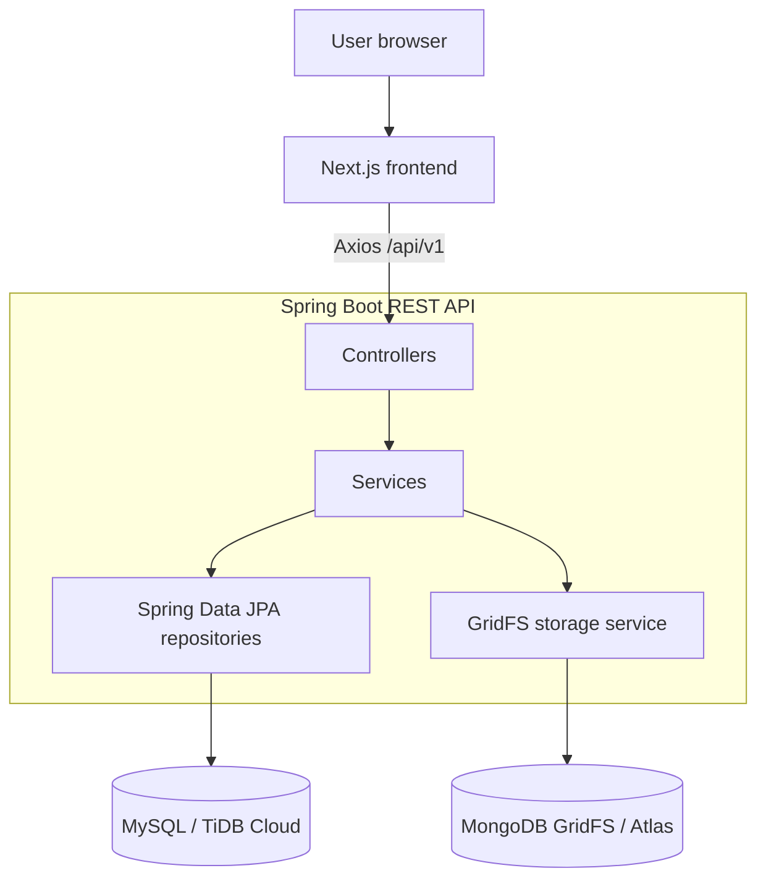

# Help Desk — IT Service Management

**English | [Español](./README.es.md)**

A full-stack **IT Service Management (ITSM)** application for managing IT support requests, tracking ticket activity, and organizing service desk operations.

Built with **Java, Spring Boot, Next.js, TypeScript, MySQL, and MongoDB**, the project demonstrates end-to-end software development, secure session management, role-based authorization, REST API design, hybrid data persistence, automated testing, and reproducible local deployment with Docker Compose.

## Features

- **Authentication and authorization:** JWT access tokens, rotating refresh tokens in HttpOnly cookies, automatic session renewal, BCrypt password hashing, and role-based access control.
- **Ticket management:** Create, update, assign, prioritize, and track support requests throughout their lifecycle.
- **Search and filtering:** Server-side pagination, sorting, and dynamic filters.
- **Comments and activity history:** Public and internal comments, with chronological tracking of ticket changes.
- **File attachments:** Upload, download, and preview GridFS-backed PDF, JPEG, and PNG attachments on tickets and comments.
- **User profiles:** Edit personal information, change passwords, and upload, replace, or remove profile pictures according to account permissions. Avatar changes are reflected in the application header without reloading the page. `admin_demo`, `technician_demo`, and `user_demo` can upload, replace, or delete their own avatars. Their personal details are read-only and password changes are disabled.
- **Dashboard:** Role-specific statistics and recent tickets, with quick actions for administrators and technicians.
- **Administration:** Manage users, departments, categories, priorities, and statuses, and view configured roles.
- **Internationalization:** English and Spanish interfaces with language selection.
- **Development and delivery:** Separate Docker Compose environments, automatic development reloads, and multi-stage builds for compiled application images.
- **Quality checks:** Backend and frontend automated tests, linting, and build checks.

## Tech Stack

| Layer                  | Technologies |
| ---------------------- | ------------ |
| Frontend               | Next.js 16 (App Router), React 19, TypeScript 5 |
| UI                     | Material UI, MUI X Data Grid |
| API client / i18n      | Axios, next-intl |
| Backend                | Java 17, Spring Boot 4.1.1, Spring MVC, Spring Security |
| Authentication         | JWT access tokens (HS256), BCrypt password hashing, rotating refresh tokens in HttpOnly cookies |
| Relational persistence | MySQL 8.4 (local), TiDB Cloud (hosted), Spring Data JPA, Hibernate |
| File storage           | MongoDB 8.0 (local), MongoDB Atlas (cloud), Spring Data MongoDB, GridFS |
| Local infrastructure   | Docker, Docker Compose, Compose Watch |
| Cloud deployment       | Vercel (frontend), Render (backend) |
| Testing                | JUnit Jupiter 6, Mockito, Spring MockMvc, Vitest, React Testing Library |
| Tooling                | Maven, npm, ESLint, Git |

## Architecture



The REST API under `/api/v1` uses a layered architecture. Controllers define HTTP endpoints and validate request DTOs. Services apply business rules and coordinate persistence through Spring Data repositories and the GridFS storage service. A centralized exception handler maps errors to HTTP responses. JPA specifications build dynamic ticket queries.

### Authentication and authorization

Spring Security checks login credentials against BCrypt password hashes. Login returns a short-lived JWT access token and sets an `HttpOnly` cookie containing the refresh token. The frontend stores the access token in `localStorage` and sends it as a Bearer token on protected API requests.

When a protected request returns `401`, Axios can renew the session through the refresh endpoint and retry the request once. The backend validates the refresh token, revokes it, and issues a replacement in the cookie along with a new access token in the response. The relational database stores refresh token hashes.

The frontend uses roles to adapt navigation and actions. Spring Security and backend services enforce endpoint and resource permissions.

### Hybrid persistence

**MySQL / TiDB Cloud** stores users and roles, departments, categories, priorities, statuses, tickets, comments, ticket history, refresh token hashes, and file and avatar metadata.

**MongoDB / MongoDB Atlas** stores binary files for ticket attachments, comment attachments, and user avatars in separate GridFS buckets.

| Functionality              | SQL metadata table           | MongoDB GridFS bucket  |
| -------------------------- | ---------------------------- | ---------------------- |
| Ticket attachments         | `ticket_attachments`         | `ticket_files`         |
| Ticket comment attachments | `ticket_comment_attachments` | `ticket_comment_files` |
| User avatars               | `user_avatars`               | `user_avatars`         |

Each SQL metadata row stores a `mongo_file_id` that references the corresponding GridFS file. The backend validates upload size and file signatures. SQL and GridFS writes are separate operations, with best-effort cleanup on metadata write failures and when avatars are replaced or removed.

### Cloud Architecture

Vercel hosts the Next.js frontend and Render hosts the Spring Boot API. TiDB Cloud holds the relational data, and MongoDB Atlas hosts the GridFS buckets.

On Vercel, `NEXT_PUBLIC_API_BASE_URL=/api/v1` sends browser API requests to the frontend origin. `BACKEND_PROXY_URL` sets the Render backend origin. The rewrites in `next.config.ts` forward `/api/v1/:path*` to the same path on that origin.

In local Docker, the browser connects directly to the published Spring Boot port. The frontend builds that API URL from `NEXT_PUBLIC_WEB_SERVER` and `NEXT_PUBLIC_WEB_PORT_BACK_END`, with the `/api/v1` prefix.

## User Roles

Roles define the application's general permissions.

| Role           | Main capabilities                                                                                           |
| -------------- | ----------------------------------------------------------------------------------------------------------- |
| **ADMIN**      | Manage all tickets, users, and configuration catalogs; access system-wide statistics.                       |
| **TECHNICIAN** | View tickets assigned to them and unassigned tickets, update tickets and add internal comments where permitted, and view statistics for their assignments. |
| **USER**       | Create support requests, follow tickets they created or that were requested for them, and add public comments. |

Administrators can view the predefined roles as a read-only catalog.

The private `admin` account retains standard `ADMIN` permissions. `admin_demo` can manage unprotected `USER` and `TECHNICIAN` accounts. Spring Boot blocks `admin_demo` from editing the four protected accounts or granting `ADMIN`. See [Demo accounts](#demo-accounts) for the protected usernames and profile restrictions.

## Getting Started with Docker

Docker runs the full Help Desk stack locally. Java, Node.js, MySQL, and MongoDB are provided by the container images.

### Requirements

- A running Docker Desktop installation or Docker Engine with the Docker Compose plugin.
- Docker Compose 2.32.0 or later for DEV, which uses the Compose Watch `restart` action. Check the installed version with `docker compose version`. [Compose Develop specification](https://docs.docker.com/reference/compose-file/develop/#action)
- Free host ports for the environment you want to run. Only the frontend and backend publish host ports.

| Environment | Frontend port | Backend port |
| ----------- | ------------- | ------------ |
| PROD (local) | `3000` | `8080` |
| DEV | `3001` | `8081` |

Run the commands below from the repository root.

### Environment files

For a new setup, copy the sample for the environment you plan to run.

```powershell
# Windows PowerShell
Copy-Item .env.sample .env
Copy-Item .env.dev.sample .env.dev
```

```bash
# Linux / macOS
cp .env.sample .env
cp .env.dev.sample .env.dev
```

Replace the placeholder passwords and JWT secrets before starting. Keep `.env`, `.env.dev`, and private credentials out of version control and off GitHub.

| PROD (`.env`) | DEV (`.env.dev`) | Purpose and local values |
| -------------- | ---------------- | ------------------------ |
| `MYSQL_ROOT_PASSWORD` | `DEV_MYSQL_ROOT_PASSWORD` | Password for the MySQL root account. |
| `DB_USERNAME` | `DEV_DB_USERNAME` | MySQL account used by Spring Boot. The samples use `helpdesk`. |
| `DB_PASSWORD` | `DEV_DB_PASSWORD` | Password for the MySQL application account. |
| `JWT_SECRET` | `DEV_JWT_SECRET` | Base64-encoded JWT signing key. |
| `FRONTEND_URL` | `DEV_FRONTEND_URL` | Browser origin allowed by the API. Use `http://localhost:3000` in PROD and `http://localhost:3001` in DEV. |
| `NEXT_PUBLIC_WEB_SERVER` | `DEV_NEXT_PUBLIC_WEB_SERVER` | Backend hostname used by the browser. Use `localhost` in both environments. |
| `NEXT_PUBLIC_WEB_PORT_BACK_END` | `DEV_NEXT_PUBLIC_WEB_PORT_BACK_END` | Published backend port used by the browser. Use `8080` in PROD and `8081` in DEV. |

### JWT signing key

Spring Boot decodes the signing key from Base64 and uses it with HS256. Generate a separate key for each environment from at least 32 cryptographically random bytes before Base64 encoding. Store the resulting string in `JWT_SECRET` or `DEV_JWT_SECRET`.

```powershell
# Windows PowerShell
$key = New-Object byte[] 32
$rng = [System.Security.Cryptography.RandomNumberGenerator]::Create()
try {
    $rng.GetBytes($key)
    [Convert]::ToBase64String($key)
} finally {
    $rng.Dispose()
}
```

```bash
# Linux / macOS with OpenSSL
openssl rand -base64 32
```

### MySQL initialization

Both Compose files mount `database/` read-only at `/docker-entrypoint-initdb.d`. MySQL executes the SQL files directly under `database/` in filename order on its first initialization with an empty volume.

1. `01_create_tables.sql` creates the tables and relationships.
2. `02_seed_reference_data.sql` loads the reference catalogs.
3. `03_seed_admin.sql` initializes the private administrator when the owner has prepared the file locally.
4. `04_seed_demo_data.sql` loads the demo accounts, sample tickets, comments, and history.

`database/.gitignore` excludes the private administrator seed from Git. On a fresh clone, use the public demo accounts below. Creating the private administrator during initial setup requires the owner's local seed to be present before MySQL initializes.

`database/local/00_setup_local_database.sql` is for manual setup outside Docker. MySQL skips the initialization scripts when it reuses an initialized volume.

### Option 1 — Run the compiled application (recommended for demonstrations)

PROD is the local production-mode build. With `.env` configured, validate the Compose configuration and start the application.

```bash
docker compose config --quiet
docker compose up -d --build
```

The build packages the backend and frontend into images. Compose then starts the application containers, MySQL, and MongoDB in the background. The backend starts after both database health checks pass.

- Frontend <http://localhost:3000>
- REST API `http://localhost:8080/api/v1`

### Option 2 — Development with live reload

With `.env.dev` configured, start the development services.

```bash
docker compose --env-file .env.dev -f docker-compose.dev.yaml config --quiet
docker compose --env-file .env.dev -f docker-compose.dev.yaml up -d --build
```

Run Compose Watch in a second terminal while developing.

```bash
docker compose --env-file .env.dev -f docker-compose.dev.yaml watch --no-up backend
```

Compose Watch restarts the running backend container when `back-end/src` or `back-end/pom.xml` changes. Maven recompiles on restart. Next.js handles frontend live reloading through Webpack and polling.

- Frontend <http://localhost:3001>
- REST API `http://localhost:8081/api/v1`

### Check and stop services

Use `ps` to check running containers and `logs` to read recent output. Use `stop` to shut down the services and retain their data.

```bash
# PROD (local)
docker compose ps
docker compose logs --tail=100 backend
docker compose logs --tail=100 mysql
docker compose stop
```

```bash
# DEV
docker compose --env-file .env.dev -f docker-compose.dev.yaml ps
docker compose --env-file .env.dev -f docker-compose.dev.yaml logs --tail=100 backend
docker compose --env-file .env.dev -f docker-compose.dev.yaml logs --tail=100 mysql
docker compose --env-file .env.dev -f docker-compose.dev.yaml stop
```

### Persistent data

DEV and PROD use separate named volumes for MySQL and MongoDB. Stopping services keeps the containers and volumes. Recreating containers replaces them and reattaches their existing named volumes, which preserve the data.

**`docker compose down -v` removes the selected project's declared volumes and their stored MySQL and MongoDB data.**

For rebuilds, troubleshooting, and the daily development workflow, see [Docker Workflow](./DOCKER-WORKFLOW.md).

### Demo accounts

The included seed data provides three public demo accounts for exploring the application roles.

| Username          | Password                  | Role       |
| ----------------- | ------------------------- | ---------- |
| `admin_demo`      | `admin_demo12345678`      | ADMIN      |
| `technician_demo` | `technician_demo12345678` | TECHNICIAN |
| `user_demo`       | `user_demo12345678`       | USER       |

Spring Boot enforces the account restrictions on the server.

- `admin_demo` can view all users and edit regular users and technicians. The `admin`, `admin_demo`, `technician_demo`, and `user_demo` accounts are read-only for `admin_demo` in the Users module. `admin_demo` cannot grant the `ADMIN` role.
- `technician_demo` and `user_demo` can use the features available to their respective roles.
- All three demo accounts have read-only personal details and cannot change their passwords. They can upload, replace, or delete their own avatars.
- Visitors can sign in as `admin_demo` to create additional `USER` or `TECHNICIAN` test accounts and try the permitted user management operations.
- `admin` is the private administrator account.

Do not commit `.env`, `.env.dev`, or any real credentials. PROD in this repository means a **local production-mode build**, not a hardened public production deployment.

## Manual Setup (without Docker)

Install JDK 17, Node.js 22 (22.22.2 or later in the 22.x series for the locked dependencies), npm, MySQL 8, and MongoDB 8. The Maven Wrapper is included in `back-end/`.

### Prepare MySQL and MongoDB

Start both database servers. In a MySQL client connected as an administrator, run `database/local/00_setup_local_database.sql` to create the `helpdesk` database. Create or select a dedicated MySQL account with read and write access to `helpdesk` for Spring Boot.

Initialize the new database by running these files in order.

1. `database/01_create_tables.sql` creates the schema and relationships.
2. `database/02_seed_reference_data.sql` loads the reference catalogs.
3. `database/03_seed_admin.sql` creates the private administrator when the owner has prepared this Git-ignored file locally.
4. `database/04_seed_demo_data.sql` loads the public demo accounts and sample ticket data.

Complete MySQL initialization before starting Spring Boot. Hibernate uses `spring.jpa.hibernate.ddl-auto=validate` and expects the schema to exist already. MongoDB stores binary files in the `helpdesk_attachments` database through GridFS. The backend creates the GridFS collections as needed. The SQL scripts apply only to MySQL. See the [Database README](./database/README.md).

### Configure and run Spring Boot

Set these environment variables in the terminal that will launch Spring Boot, or in your IDE run configuration.

```dotenv
DB_URL=jdbc:mysql://localhost:3306/helpdesk
DB_USERNAME=replace_with_local_mysql_username
DB_PASSWORD=replace_with_local_mysql_password
JWT_SECRET=replace_with_generated_base64_key
FRONTEND_URL=http://localhost:3000
MONGODB_URI=mongodb://localhost:27017/helpdesk_attachments
```

In PowerShell, use `$env:NAME = 'value'` for each variable. On Linux or macOS, use `export NAME='value'`. Use your MySQL account credentials and generate `JWT_SECRET` with the [JWT signing key examples](#jwt-signing-key). Keep credentials and signing keys out of version control.

Run the Maven Wrapper from `back-end/`.

```powershell
# Windows PowerShell
.\mvnw.cmd spring-boot:run
```

```bash
# Linux / macOS
chmod u+x mvnw
./mvnw spring-boot:run
```

Spring Boot defaults to port `8080` and serves the API under `/api/v1`. See the [Backend README](./back-end/README.md) for additional configuration.

### Configure and run Next.js

From `front-end/`, copy `.env.sample` to `.env` with `Copy-Item .env.sample .env` in PowerShell or `cp .env.sample .env` on Linux or macOS. Set these values in `front-end/.env`.

```dotenv
NEXT_PUBLIC_WEB_SERVER=localhost
NEXT_PUBLIC_WEB_PORT_BACK_END=8080
```

Leave the Vercel proxy variable `NEXT_PUBLIC_API_BASE_URL` unset for this setup. With the local values, Next.js sends browser requests to `http://localhost:8080/api/v1`.

```bash
npm ci
npm run dev
```

Open <http://localhost:3000>. See the [Frontend README](./front-end/README.md) for more details.

### Verify the local setup

1. Connect to `helpdesk` with the application's MySQL account and run `SHOW TABLES;`. Check MongoDB with `db.runCommand({ ping: 1 })` in the MongoDB shell.
2. Check the Spring Boot startup logs for connection or schema validation errors.
3. Open the frontend and sign in with a [demo account](#demo-accounts) if you loaded the demo seed. In the browser's Network panel, confirm that `POST http://localhost:8080/api/v1/auth/login` succeeds.

## Testing and Quality Checks

### Backend tests

The backend uses **JUnit Jupiter 6** and **Mockito** for controller and service tests. The tests cover authentication, users, tickets, comments, history, and configuration catalogs. Selected authorization tests use Spring MockMvc with mocked dependencies to check access to ticket resources and restrictions on protected accounts, ADMIN role assignment, and demo profile changes.

Run the Maven Wrapper from `back-end/`. On Linux or macOS, set its execute permission as shown in [Manual Setup](#manual-setup-without-docker).

```powershell
# Windows PowerShell
.\mvnw.cmd clean verify
```

```bash
# Linux / macOS
./mvnw clean verify
```

Maven clears previous build output, compiles the application and test sources, runs the configured tests, and packages the application through the `verify` phase.

### Frontend tests

The frontend uses **Vitest** and **React Testing Library** to test API service calls, Axios token refresh behavior, and selected components such as forms and ticket dialogs.

From `front-end/`, run the suite once with `npm run test:run`. Use `npm test` to run Vitest in interactive watch mode while editing tests.

### Frontend quality checks

- `npm run lint` runs ESLint with the configured static analysis rules.
- `npm run build` checks that Next.js can compile and generate the production build.

Run the functional tests as well to check behavior. Before integrating significant frontend changes, configure the API variables as described in [Manual Setup](#manual-setup-without-docker) and ensure the full check completes successfully from `front-end/`.

```bash
npm ci
npm run check
```

`npm ci` installs dependencies from the lockfile. `npm run check` runs ESLint, Vitest once, and the Next.js production build in that order. It stops if a step fails.

### Integration checks

Supplement the automated suite with checks against the running application. Verify authentication and authorization through the live API, Spring Boot's connection to MySQL, file uploads and retrieval through MongoDB GridFS, and end-to-end requests between Next.js and Spring Boot.

## Repository Structure

```text
IT-Service-Management/
├── back-end/                 # Spring Boot REST API and backend tests
│   ├── Dockerfile
│   ├── Dockerfile.dev
│   └── README.md
├── front-end/                # Next.js application and frontend tests
│   ├── Dockerfile
│   ├── Dockerfile.dev
│   └── README.md
├── database/                 # MySQL schema and demo data
│   ├── local/
│   │   └── 00_setup_local_database.sql
│   ├── 01_create_tables.sql
│   ├── 02_seed_reference_data.sql
│   ├── 03_seed_admin.sql      # Private local file prepared by the owner and ignored by Git
│   ├── 04_seed_demo_data.sql
│   └── README.md
├── docker-compose.yaml
├── docker-compose.dev.yaml
├── .env.sample
├── .env.dev.sample
├── DOCKER-WORKFLOW.md
├── GIT_WORKFLOW.md
├── LICENSE
└── README.md
```

- `local/00_setup_local_database.sql` creates the local `helpdesk` database for manual setup.
- `01_create_tables.sql` creates the tables and their relationships.
- `02_seed_reference_data.sql` loads the initial configuration, including roles, departments, categories, priorities, and statuses.
- `03_seed_admin.sql` creates the private administrator. The owner prepares this file locally after cloning, and `database/.gitignore` excludes it from Git.
- `04_seed_demo_data.sql` adds the demo accounts, sample tickets, comments, and ticket history.

The initialization order is `01`, `02`, `03` when the private seed is present, then `04`. Docker runs only the SQL scripts directly under `database/` when MySQL first initializes an empty volume. MySQL skips initialization when it reuses an existing volume.

## Project Documentation

| Document                                | Contents                                                        |
| --------------------------------------- | --------------------------------------------------------------- |
| [Backend](./back-end/README.md)         | API architecture, security, configuration, endpoints, and tests |
| [Frontend](./front-end/README.md)       | UI architecture, environment setup, authentication, and tests   |
| [Database](./database/README.md)        | MySQL schema, initialization, and demo data                     |
| [Docker Workflow](./DOCKER-WORKFLOW.md) | Docker environments, commands, and development workflow         |
| [Git Workflow](./GIT_WORKFLOW.md)       | Branches, commits, pull requests, and collaboration guidelines  |

## License

Copyright © 2026 Diego González Sanz. All Rights Reserved.

This project is published for portfolio viewing and evaluation; it is **not open source**. Reuse, modification, and redistribution require prior written permission. See [LICENSE](./LICENSE) for the full terms.
