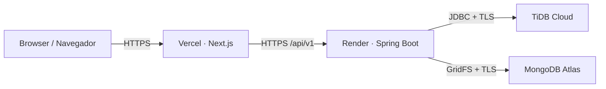

# Despliegue en la nube — Help Desk

[English](./DEPLOYMENT.md) | **Español**

Esta guía explica cómo desplegar el frontend de Help Desk en Vercel y el backend de Spring Boot en Render, con TiDB Cloud y MongoDB Atlas como almacenes de datos. La configuración y las comprobaciones de esta guía están dirigidas a quien realiza el despliegue.

## Arquitectura y entornos

El navegador carga Next.js desde Vercel y envía las peticiones de la API a `/api/v1` en el mismo origen. Las reglas de reescritura de Next.js reenvían esas peticiones por HTTPS a la API de Spring Boot en Render. Spring Boot se conecta a TiDB Cloud mediante MySQL Connector/J y a MongoDB Atlas mediante el controlador de MongoDB. TiDB guarda los datos relacionales y los metadatos de archivos. GridFS en Atlas almacena el contenido binario de los adjuntos y avatares.



| Entorno           | Aplicaciones                                                                                                      | Bases de datos                                                                                                  |
| ----------------- | ----------------------------------------------------------------------------------------------------------------- | --------------------------------------------------------------------------------------------------------------- |
| Docker DEV        | Next.js en `http://localhost:3001` y Spring Boot en `http://localhost:8081/api/v1`, con el código fuente montado. | MySQL y MongoDB en `helpdesk-dev`.                                                                              |
| Docker PROD local | Imágenes compiladas en `http://localhost:3000` y `http://localhost:8080/api/v1`.                                  | MySQL y MongoDB en `helpdesk-prod`.                                                                             |
| Nube pública      | Vercel compila Next.js y Render construye la imagen de Spring Boot. El navegador usa el origen HTTPS de Vercel.   | TiDB Cloud y MongoDB Atlas se aprovisionan por separado. Quien realiza el despliegue inicializa el esquema SQL. |

Los archivos de Compose y las plantillas de entorno describen la configuración local. Guarda la configuración cloud en los paneles de los proveedores. [Flujo de trabajo con Docker](../DOCKER-WORKFLOW.es.md)

## TiDB Cloud — datos relacionales

1. En TiDB Cloud, crea una instancia o un clúster **compatible con MySQL**. Abre el diálogo de conexión y anota el nombre del host, el puerto, el formato del nombre de usuario y las instrucciones sobre la CA para el tipo de conexión elegido. Restringe el acceso de red al equipo de configuración y a las direcciones salientes de Render cuando el clúster permita configurar una lista de IP autorizadas. Usa la configuración de conexión de tu plan y exige TLS. [Métodos de conexión a TiDB Cloud](https://docs.pingcap.com/tidbcloud/connect-to-tidb-cluster-serverless/) · [Conexiones a TiDB Cloud Dedicated](https://docs.pingcap.com/tidbcloud/connect-via-standard-connection/)
2. Usa una cuenta de preparación con permisos para crear el esquema y cargar sus datos iniciales. Crea un usuario de aplicación independiente con los permisos de lectura y escritura que Spring Boot necesita sobre `helpdesk`, incluidos `SELECT`, `INSERT`, `UPDATE` y `DELETE`. Reserva la administración del esquema para la cuenta de preparación.
3. Conéctate con un cliente MySQL. Sustituye el host, el puerto, el nombre de usuario de preparación y la ruta al archivo de la CA según las instrucciones de conexión. La opción `-p` solicita la contraseña. Verifica el nombre de host y el certificado del servidor. [TLS en TiDB Cloud Starter y Essential](https://docs.pingcap.com/tidbcloud/secure-connections-to-serverless-clusters/) · [TLS en TiDB Cloud Dedicated](https://docs.pingcap.com/tidbcloud/tidb-cloud-tls-connect-to-dedicated/)

   ```bash
   mysql --host=TIDB_HOST --port=TIDB_PORT --user=TIDB_USER --ssl-mode=VERIFY_IDENTITY --ssl-ca=CA_FILE -p
   ```

4. Crea `helpdesk` y ejecuta los archivos SQL de `database/` con tu cliente MySQL sobre el esquema nuevo y vacío. Si iniciaste el cliente `mysql` desde la raíz del repositorio, utiliza `SOURCE` como en el ejemplo. Ejecuta los scripts opcionales en el orden indicado abajo con el mismo comando.

   ```sql
   CREATE DATABASE IF NOT EXISTS helpdesk CHARACTER SET utf8mb4;
   USE helpdesk;
   SOURCE database/01_create_tables.sql;
   SOURCE database/02_seed_reference_data.sql;
   ```

| Orden | Script                       | Finalidad                                                                                                                                                          |
| ----- | ---------------------------- | ------------------------------------------------------------------------------------------------------------------------------------------------------------------ |
| 1     | `01_create_tables.sql`       | Crea las tablas y las claves foráneas.                                                                                                                             |
| 2     | `02_seed_reference_data.sql` | Inserta los catálogos iniciales y los roles.                                                                                                                       |
| 3     | `03_seed_admin.sql`          | Inicializa la cuenta de administración privada si el propietario ha preparado el archivo local. Git lo ignora y el archivo no se incluye al clonar el repositorio. |
| 4     | `04_seed_demo_data.sql`      | Carga las cuentas públicas y los datos de ejemplo cuando se despliega la demo del portafolio. Funciona sin el script privado.                                      |

En Docker local, la imagen de MySQL ejecuta los archivos SQL del directorio raíz de la base de datos al inicializar un volumen vacío. En la nube, ejecuta los scripts antes de arrancar Render. El Dockerfile empaqueta el backend y Hibernate usa `spring.jpa.hibernate.ddl-auto=validate` para comprobar el esquema existente. Mantén el script privado en local y evita volver a ejecutar los scripts de datos iniciales sobre una base ya existente. [Inicialización de la base de datos](../database/README.es.md#scripts-sql-de-inicialización)

Ejecuta las siguientes comprobaciones de solo lectura. Deben aparecer 13 tablas y los roles `ADMIN`, `TECHNICIAN` y `USER`. Si ejecutaste el script de demostración sobre una tabla de tickets vacía, deben aparecer 60 tickets. Conéctate de nuevo con el usuario de la aplicación y confirma que puede leer el esquema mediante TLS con validación del servidor. Guarda en Render solo las credenciales que se utilizarán en ejecución.

```sql
USE helpdesk;
SELECT 1;
SHOW TABLES;
SELECT name FROM roles ORDER BY name;
SELECT COUNT(*) AS total_tickets FROM tickets;
```

En Render, utiliza el nombre del host y el puerto de TiDB en la URL JDBC. `sslMode=VERIFY_IDENTITY` comprueba la cadena de certificados y el nombre del host. Usa la CA que requiere el clúster y configura su confianza en Connector/J dentro del entorno de ejecución de Java si no está presente en el almacén de confianza predeterminado. Configura `DB_USERNAME` y `DB_PASSWORD` por separado de la URL. [Configuración JDBC de TiDB Cloud](https://docs.pingcap.com/developer/dev-guide-sample-application-java-jdbc/) · [Autenticación del servidor con Connector/J](https://dev.mysql.com/doc/connector-j/en/connector-j-server-authentication.html)

```dotenv
DB_URL=jdbc:mysql://TIDB_HOST:TIDB_PORT/helpdesk?sslMode=VERIFY_IDENTITY
```

## MongoDB Atlas — almacenamiento binario

1. Crea un clúster de Atlas. En la configuración de acceso de red, permite las direcciones salientes del servicio de Render y añade la de tu equipo de configuración solo cuando sea necesario. En Render, consulta los rangos del servicio en **Connect → Outbound**. Los rangos regionales son compartidos. Las direcciones de salida dedicadas o la conectividad privada permiten un control más estricto cuando los productos y la red elegidos lo admiten. Una regla abierta `0.0.0.0/0` permite intentos de conexión desde Internet. [Clústeres de Atlas](https://www.mongodb.com/docs/atlas/create-database-deployment/) · [Requisitos de conexión a Atlas](https://www.mongodb.com/docs/atlas/connect-to-database-deployment/) · [Direcciones salientes de Render](https://render.com/docs/outbound-ip-addresses)
2. Crea un **usuario de base de datos** de Atlas para el backend con el rol `readWrite` limitado a `helpdesk_attachments`. Ese ámbito permite las subidas, lecturas y eliminaciones de GridFS que realiza la aplicación. Mantén esas credenciales separadas de tu cuenta del panel de Atlas.
3. En Atlas, selecciona la conexión mediante controlador y obtén la URI para Java. Añade el nombre de base de datos `helpdesk_attachments` a la ruta de la URI antes de la cadena de consulta y conserva los parámetros de conexión de Atlas. Codifica los caracteres reservados de las credenciales según el formato de URI. Guarda la URI completa solo como `MONGODB_URI` en Render. `mongodb+srv://` habilita TLS por defecto en el controlador de Java. Mantén activada la validación de certificados y del nombre de host. [Configuración del controlador de Atlas](https://www.mongodb.com/docs/atlas/driver-connection/) · [TLS en el controlador de Java de MongoDB](https://www.mongodb.com/docs/drivers/java/sync/current/security/tls/)

| Bucket de GridFS       | Tipo de archivo         | Tabla SQL de metadatos       |
| ---------------------- | ----------------------- | ---------------------------- |
| `ticket_files`         | Adjuntos de tickets     | `ticket_attachments`         |
| `ticket_comment_files` | Adjuntos de comentarios | `ticket_comment_attachments` |
| `user_avatars`         | Imágenes de perfil      | `user_avatars`               |

GridFS crea las colecciones `.files` y `.chunks` del bucket cuando necesita almacenar archivos. En un despliegue nuevo, la base de datos puede estar vacía hasta la primera subida. Una subida de prueba durante la validación basta para inicializar esas colecciones. [GridFS con el controlador de Java](https://www.mongodb.com/docs/drivers/java/sync/current/crud/gridfs/)

## Render — Spring Boot

Crea un **Web Service** en Render, conecta el repositorio Git de Help Desk y la rama que quieras desplegar y selecciona **Docker** como entorno de ejecución. Configura **Root Directory** como `back-end`, **Dockerfile Path** como `./Dockerfile` y el contexto de construcción de Docker como `.` relativo a esa raíz. Así se selecciona `back-end/Dockerfile`, que construye un JAR con Maven y lo ejecuta en Java 17 con su punto de entrada actual. Deja vacío el campo para sustituir el comando de Docker. [Docker en Render](https://render.com/docs/docker) · [Rutas relativas al directorio raíz en Render](https://render.com/docs/monorepo-support#root-relative-settings)

### Variables de entorno del backend

Configura estos valores en el entorno del servicio de Render. Usa los orígenes HTTPS que indican los paneles. Sustituye el host y el puerto de los ejemplos por los valores reales.

| Variable                              | Requisito y valor                                                                                                                                                                                   |
| ------------------------------------- | --------------------------------------------------------------------------------------------------------------------------------------------------------------------------------------------------- |
| `DB_URL`                              | Obligatoria. Usa la URL JDBC de TiDB, con validación del certificado y del nombre de host, según el ejemplo anterior.                                                                               |
| `DB_USERNAME`                         | Obligatoria. Usa el nombre de usuario de la aplicación en TiDB con el formato completo de conexión.                                                                                                 |
| `DB_PASSWORD`                         | Obligatoria. Usa la contraseña de la aplicación en TiDB. Guárdala como secreto.                                                                                                                     |
| `MONGODB_URI`                         | Obligatoria en este despliegue cloud. Usa la URI del controlador de Atlas para `helpdesk_attachments`. Para uso local, el código toma por defecto `mongodb://localhost:27017/helpdesk_attachments`. |
| `JWT_SECRET`                          | Obligatoria. Usa una clave de firma codificada en Base64 a partir de al menos 32 bytes generados de forma criptográficamente segura. Guárdala como secreto.                                         |
| `FRONTEND_URL`                        | Obligatoria. Usa el origen HTTPS exacto de Vercel, como `https://VERCEL_HOST`, sin ruta ni barra final.                                                                                             |
| `COOKIE_SECURE`                       | Configura `true` para HTTPS en la nube. El valor predeterminado de la aplicación es `false` para uso local.                                                                                         |
| `SERVER_PORT`                         | Opcional. Si se configura, prevalece sobre `PORT`. Déjala sin definir para usar el puerto que suministra Render.                                                                                    |
| `PORT`                                | Render la suministra al Web Service. Spring Boot la usa si `SERVER_PORT` está sin definir y utiliza `8080` si faltan ambas.                                                                         |
| `JWT_ACCESS_TOKEN_EXPIRATION_MINUTES` | Opcional. El valor predeterminado es de `15` minutos.                                                                                                                                               |
| `JWT_REFRESH_TOKEN_EXPIRATION_DAYS`   | Opcional. El valor predeterminado es de `7` días.                                                                                                                                                   |

Consulta las instrucciones sobre la clave de firma en el README principal y guarda la clave resultante en Render. [Clave de firma de JWT](../README.es.md#clave-de-firma-de-jwt) · [Variables de entorno y secretos en Render](https://render.com/docs/configure-environment-variables)

La instrucción `EXPOSE 8080` del contenedor no fija el puerto de escucha del servidor. Spring Boot resuelve `server.port` primero desde `SERVER_PORT`, luego desde `PORT` y, en último lugar, usa `8080`. Comprueba el puerto de escucha en los registros de ejecución. El repositorio carece de un endpoint HTTP dedicado al estado del servicio. Usa la comprobación de estado TCP predeterminada de Render y verifica el comportamiento de la aplicación mediante las comprobaciones de API descritas abajo. [Puerto de escucha en Render](https://render.com/docs/web-services#port-binding) · [Comprobaciones de estado en Render](https://render.com/docs/health-checks)

Despliega el servicio después de inicializar el esquema SQL y configurar su entorno. Revisa la salida de compilación y **Logs** para detectar fallos de arranque y comprobar el puerto de escucha y la validación del esquema vía JDBC. Consulta la revisión activa en el historial de despliegues. Cuando hay cambios en Git, Render despliega la rama vinculada según la configuración automática del servicio. Si el despliegue automático está desactivado, inicia un despliegue manual desde el panel. Tras cambiar variables, despliega con los valores guardados y repite las comprobaciones correspondientes. [Funcionamiento de los despliegues en Render](https://render.com/docs/deploys)

## Vercel — Next.js

1. Importa el mismo repositorio Git en Vercel. Elige la rama de producción que corresponda y configura **Root Directory** como `front-end`. Selecciona el preajuste de **Next.js** y Node.js `22.x`, con una versión de parche compatible con el archivo de bloqueo. El Dockerfile del repositorio también usa Node.js 22 para Docker local. [Configuración de compilación en Vercel](https://vercel.com/docs/builds/configure-a-build) · [Versiones de Node.js en Vercel](https://vercel.com/docs/functions/runtimes/node-js/node-js-versions)
2. Usa el archivo de bloqueo del repositorio para instalar dependencias. Puedes configurar `npm ci` como comando de instalación. Usa la configuración de compilación de Next.js con `npm run build` de `front-end/package.json` y deja que el framework gestione la salida con sus valores predeterminados. Vercel construye el proyecto Next.js directamente.
3. En el entorno de producción de Vercel, configura las variables siguientes. Sustituye `RENDER_HOST` por el host del servicio HTTPS de Render. Mantén el valor de `BACKEND_PROXY_URL` limitado al origen, sin `/api/v1`.

   ```dotenv
   NEXT_PUBLIC_API_BASE_URL=/api/v1
   BACKEND_PROXY_URL=https://RENDER_HOST
   ```

`NEXT_PUBLIC_API_BASE_URL` se incorpora a la compilación que recibe el navegador. `next.config.ts` lee `BACKEND_PROXY_URL` en el servidor para reenviar `/api/v1/:path*` a la misma ruta en Render. Guarda en Render las credenciales de base de datos y `JWT_SECRET`. Los valores locales de `NEXT_PUBLIC_WEB_SERVER` y `NEXT_PUBLIC_WEB_PORT_BACK_END` se usan para peticiones directas del navegador en los entornos locales. [Variables de entorno en Vercel](https://vercel.com/docs/environment-variables) · [Reescrituras a orígenes externos en Vercel](https://vercel.com/docs/routing/rewrites#rewrites-to-external-origins)

Despliega el frontend con ambos valores, abre el dominio HTTPS de producción y consulta el panel de red del navegador. Si Vercel asigna el dominio definitivo después del primer despliegue, despliega primero con `NEXT_PUBLIC_API_BASE_URL` igual a `/api/v1` y la variable del proxy sin definir. Usa el origen asignado en `FRONTEND_URL` de Render, despliega Render y después configura `BACKEND_PROXY_URL` y vuelve a desplegar Vercel antes de probar la API.

Despliega los cambios posteriores de Git con la rama de producción configurada. Los cambios de entorno se aplican en un nuevo despliegue, así que vuelve a desplegar tras modificar cualquiera de las dos variables. Los despliegues de vista previa tienen valores y orígenes propios. Spring Boot admite un solo origen mediante `FRONTEND_URL`. Para comprobar una vista previa que necesita otro origen, utiliza un backend configurado para ese origen. [Ámbitos de las variables en Vercel](https://vercel.com/docs/environment-variables#environments)

## Comunicación de la API y autenticación

1. El navegador envía las credenciales a `POST /api/v1/auth/login` en el origen de Vercel. Spring Boot devuelve un JWT de acceso de corta duración y una cookie `HttpOnly` llamada `refreshToken`. El navegador puede recibir la cookie a través de la reescritura mientras sigue usando el origen de Vercel.
2. El frontend envía el JWT de acceso con `Authorization: Bearer <access-token>` en las peticiones protegidas. Ante un `401` que admite renovación, el interceptor de Axios envía `POST /api/v1/auth/refresh` con la cookie y, si la renovación tiene éxito, reintenta una vez la petición original.
3. Spring Boot valida y rota el token de renovación y guarda su hash SHA-256 en la base de datos relacional. La cookie usa `SameSite=Strict` y `Path=/api/v1/auth`. Con `COOKIE_SECURE=true`, el navegador la envía por HTTPS. Al cerrar sesión, el backend revoca el token de renovación recibido y expira la cookie.

Spring Boot aplica CORS con el origen exacto de `FRONTEND_URL`. El proxy ofrece al navegador una URL de API del mismo origen. Comprueba que la cabecera `Origin`, si se reenvía, coincida con la configuración del backend, especialmente si cambia el dominio del frontend. Spring Security y los servicios del backend aplican la autenticación, los roles y el acceso a los recursos. Las pantallas del frontend usan el rol actual para presentar los controles disponibles. [Autenticación y autorización del backend](../back-end/README.es.md#autenticación-y-autorización)

## Cuentas públicas de demostración

El script de demostración proporciona `admin_demo`, `technician_demo` y `user_demo`. Sus credenciales públicas de acceso están en el README principal. [Cuentas de demostración](../README.es.md#cuentas-de-demostración)

- Las tres cuentas tienen los datos personales en modo de solo lectura y no pueden cambiar sus contraseñas. Cada una puede subir, sustituir y eliminar su propio avatar.
- `admin_demo` puede gestionar usuarios normales y técnicos no protegidos. Spring Boot le impide modificar `admin`, `admin_demo`, `technician_demo` y `user_demo` o conceder el rol `ADMIN`.
- Usa solo datos ficticios. Los visitantes pueden realizar cambios permitidos sobre datos compartidos de la demo, como tickets, comentarios y avatares. Otros visitantes pueden ver esos cambios. El repositorio carece de un mecanismo de restablecimiento automático de la demo.

## Verificación posterior al despliegue

Ejecuta esta lista de comprobaciones después del despliegue. Registra el entorno, la revisión y el resultado de cada comprobación.

| Comprobación                     | Cómo verificarla                                                                                                                                                                                                                                                                                                                                                                                                                                                                             |
| -------------------------------- | -------------------------------------------------------------------------------------------------------------------------------------------------------------------------------------------------------------------------------------------------------------------------------------------------------------------------------------------------------------------------------------------------------------------------------------------------------------------------------------------- |
| Arranque del backend             | Revisa los registros de ejecución de Render para confirmar que Spring Boot ha arrancado, escucha en el puerto esperado y que se han resuelto los errores de arranque.                                                                                                                                                                                                                                                                                                                        |
| Conexión a TiDB                  | Confirma que Hibernate valida el esquema y que la API lee los datos relacionales iniciales. Si falla, revisa los errores JDBC en los registros de Render.                                                                                                                                                                                                                                                                                                                                    |
| Conexión a Atlas                 | Comprueba si Render registra errores de conexión con MongoDB. Confirma una subida y recuperación reales mediante una operación que utilice GridFS, porque el arranque por sí solo no comprueba el almacenamiento.                                                                                                                                                                                                                                                                            |
| Proxy de Vercel a Render         | En el panel de red del navegador, comprueba que una petición a la API utiliza el origen de Vercel bajo `/api/v1` y devuelve una respuesta de Spring Boot. Si falla, consulta los registros de despliegue de Vercel y los de ejecución de Render.                                                                                                                                                                                                                                             |
| Inicio de sesión                 | Inicia sesión desde la interfaz de Vercel con una cuenta de prueba autorizada. Comprueba que `POST /api/v1/auth/login` tiene éxito y que el navegador acepta la cookie de renovación con `HttpOnly`, `Secure` y `SameSite=Strict`. Mantén los valores de los tokens y las cookies fuera de los registros compartidos.                                                                                                                                                                        |
| Renovación de la sesión          | Mantén la sesión iniciada hasta que expire el token de acceso. Lanza una petición protegida y comprueba que `POST /api/v1/auth/refresh` tiene éxito, que se rota la cookie y que se completa el reintento.                                                                                                                                                                                                                                                                                   |
| Acceso a tickets de demostración | Prueba `GET /api/v1/tickets` con `admin_demo`, `GET /api/v1/tickets/assigned` con `technician_demo` y `GET /api/v1/tickets/my` con `user_demo`. Compara los resultados con los tickets visibles para cada rol.                                                                                                                                                                                                                                                                               |
| Comentarios                      | Añade un comentario público a un ticket de prueba para el que tengas permiso mediante `POST /api/v1/ticket-comments/ticket/{id}` y confirma que aparece tras recargar.                                                                                                                                                                                                                                                                                                                       |
| Adjuntos y avatares              | Sube y recupera un archivo de prueba pequeño mediante `/api/v1/tickets/{ticketId}/attachments` o `/api/v1/tickets/{ticketId}/comments/{commentId}/attachments` con una cuenta autorizada a subir archivos. Sube, sustituye y elimina el avatar de prueba de una cuenta demo mediante `/api/v1/users/me/avatar`. Comprueba los metadatos y el bucket de GridFS correspondientes si tienes acceso.                                                                                             |
| Restricciones DEMO en la API     | Con las cuentas demo, comprueba que los intentos válidos de editar los datos personales mediante `PUT /api/v1/users/me` o cambiar la contraseña mediante `PUT /api/v1/users/change-password` devuelven `403`. Como `admin_demo`, comprueba el `403` al intentar editar a un usuario protegido mediante `PUT /api/v1/users/{id}` o crear un usuario con rol `ADMIN` mediante `POST /api/v1/users`. Realiza las comprobaciones de escritura en una demo controlada o en un entorno de pruebas. |

## Solución de problemas

| Síntoma                                                        | Dónde buscar y qué comprobar                                                                                                                                                                                                                                                                                                                                         |
| -------------------------------------------------------------- | -------------------------------------------------------------------------------------------------------------------------------------------------------------------------------------------------------------------------------------------------------------------------------------------------------------------------------------------------------------------- |
| Falla la compilación en Render                                 | Localiza el primer paso fallido en el registro de compilación de Render. Comprueba el Dockerfile versionado, el contexto de construcción, `pom.xml` y la resolución de dependencias de Maven. Si falla la compilación en Vercel, revisa el registro de compilación, el directorio raíz, la versión de Node.js y la instalación desde el archivo de bloqueo.          |
| Faltan variables o falla el arranque                           | Comprueba que el entorno del servicio de Render contiene todos los valores obligatorios del backend. En Vercel, revisa los nombres de variables y el ámbito del despliegue. Las plantillas locales no rellenan los entornos de los servicios cloud.                                                                                                                  |
| Falla la conexión JDBC con TiDB                                | Busca errores de autenticación, tiempo de espera, TLS o validación de esquema en los registros de ejecución de Render. Confirma el host y el puerto de TiDB, el formato de usuario, el nombre de base de datos, el acceso de red y la CA en la que confía el entorno de ejecución. Confirma que los scripts SQL se completaron en el esquema previsto.               |
| Error de TLS o acceso de red con Atlas                         | Busca errores de DNS, tiempo de espera de conexión, autenticación o certificados en Render. Comprueba el acceso de red de Atlas frente a los rangos salientes del servicio de Render, los permisos del usuario, la ruta y los caracteres reservados de la URI y el almacén de confianza de Java. Mantén activados TLS y la validación del nombre de host.            |
| Error CORS o rechazo del origen                                | Comprueba la URL de la petición y `Origin` en el panel de red. Confirma que las peticiones usan `/api/v1` en Vercel y que `FRONTEND_URL` coincide con el origen real del frontend. Revisa si el navegador está usando un dominio de vista previa.                                                                                                                    |
| `401` o `403`                                                  | Ante un `401`, revisa las credenciales, la cabecera Bearer, la expiración y el flujo de renovación. Ante un `403`, revisa la respuesta y comprueba el rol de la cuenta, los permisos sobre el recurso o el origen de la petición. Los rechazos por las restricciones de perfil demo son esperados.                                                                   |
| El proxy devuelve `404` o `502`                                | Ante un `404`, compara el método HTTP y la ruta con la API del backend, revisa las dos variables de Vercel y comprueba que el origen del proxy carezca del sufijo `/api/v1`. Ante un `502`, revisa los registros de Vercel y Render para detectar un origen inaccesible, un problema de estado del backend, un tiempo de espera o un despliegue fallido.             |
| Falla la cookie de renovación                                  | En el navegador, comprueba si la respuesta de inicio de sesión guardó la cookie y si la petición de renovación la incluye. Revisa HTTPS, `COOKIE_SECURE`, `SameSite=Strict`, `Path=/api/v1/auth` y si el inicio de sesión y la renovación pasan por el mismo origen de Vercel. Busca expiraciones o revocaciones del token de renovación en los registros de Render. |
| Variables antiguas o comportamiento que solo funciona en local | Comprueba el despliegue activo y su ámbito en Vercel y vuelve a desplegar con los valores guardados. En Render, confirma que la revisión en ejecución utiliza el entorno previsto. Compara entre local y cloud la configuración de hosts, puertos, TLS, cookies y reescritura de Vercel.                                                                             |

## Limitaciones y seguridad

- Gestiona los secretos en las plataformas de alojamiento. Mantén las contraseñas de bases de datos, las URI con autenticación, las claves de firma y `03_seed_admin.sql` fuera de Git, de los argumentos de construcción y de los registros compartidos. Usa HTTPS y restringe los permisos y el acceso de red de las bases de datos.
- Coordina las copias de seguridad y restauraciones de TiDB y MongoDB Atlas. La copia SQL contiene las referencias a los archivos y Atlas almacena su contenido binario.
- Comprueba los límites actuales de cada plan, el almacenamiento, el ancho de banda, la disponibilidad de copias de seguridad y los costes de los cuatro proveedores. Los límites dependen del plan seleccionado y pueden cambiar. Verifica las subidas también a través de Vercel, ya que el recorrido de la petición puede imponer límites de los proveedores además de los de Spring Boot.
- La configuración versionada del backend activa `spring.jpa.show-sql=true` y `logging.level.org.hibernate.SQL=DEBUG`. Revisa los registros SQL antes de un despliegue empresarial para limitar el volumen innecesario de registros y el detalle de las consultas.
- Trata el despliegue público como una demo de portafolio con datos ficticios compartidos. Antes de usar datos empresariales reales, revisa los controles de acceso, los procedimientos de retención y copia de seguridad, la supervisión y la respuesta ante incidentes.

Consulta el [README principal](../README.es.md), la [guía de la base de datos](../database/README.es.md) y el [flujo de trabajo con Git](../GIT_WORKFLOW.es.md) para conocer los procedimientos de configuración y actualización del proyecto.
