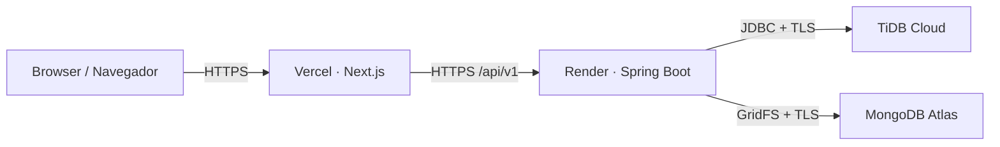

# Cloud Deployment — Help Desk

**English** | [Español](./DEPLOYMENT.es.md)

This guide describes how to deploy the Help Desk frontend to Vercel and the Spring Boot backend to Render, with TiDB Cloud and MongoDB Atlas as the data stores. The configuration and checks below are instructions for a deployment operator.

## Architecture and environments

The browser loads Next.js from Vercel and sends API requests to `/api/v1` on the same origin. Next.js rewrites forward those requests over HTTPS to the Spring Boot API on Render. Spring Boot connects to TiDB Cloud through MySQL Connector/J and to MongoDB Atlas through the MongoDB driver. TiDB stores relational data and file metadata. Atlas GridFS stores the attachment and avatar binaries.



| Environment       | Applications                                                                                                    | Databases                                                                                                    |
| ----------------- | --------------------------------------------------------------------------------------------------------------- | ------------------------------------------------------------------------------------------------------------ |
| Docker DEV        | Next.js on `http://localhost:3001` and Spring Boot on `http://localhost:8081/api/v1`, with mounted source code. | MySQL and MongoDB in `helpdesk-dev`.                                                                         |
| Local Docker PROD | Compiled images on `http://localhost:3000` and `http://localhost:8080/api/v1`.                                  | MySQL and MongoDB in `helpdesk-prod`.                                                                        |
| Public cloud      | Vercel builds Next.js, and Render builds the Spring Boot image. The browser uses the Vercel HTTPS origin.       | TiDB Cloud and MongoDB Atlas are provisioned separately. The deployment operator initializes the SQL schema. |

The Compose files and sample environment files describe local setups. Keep the cloud settings in the providers' dashboards. [Docker Workflow](../DOCKER-WORKFLOW.md)

## TiDB Cloud — relational data

1. In TiDB Cloud, create a **MySQL-compatible** instance or cluster. Open its connection dialog and record the hostname, port, username format, and CA instructions for the selected connection type. Restrict network access to the setup client and Render's outbound addresses where the cluster supports an IP allowlist. Use the connection settings supplied for your tier and enforce TLS. [TiDB Cloud connection methods](https://docs.pingcap.com/tidbcloud/connect-to-tidb-cluster-serverless/) · [TiDB Cloud Dedicated connections](https://docs.pingcap.com/tidbcloud/connect-via-standard-connection/)
2. Use a setup account with permission to create the schema and seed its data. Provision a separate application user with the read and write privileges Spring Boot needs on `helpdesk`, including `SELECT`, `INSERT`, `UPDATE`, and `DELETE`. Keep schema administration with the setup account.
3. Connect with a MySQL client. Substitute the host, port, setup username, and CA file path from the connection instructions. The `-p` option prompts for the password. Verify the server hostname and certificate. [TiDB Cloud TLS for Starter and Essential](https://docs.pingcap.com/tidbcloud/secure-connections-to-serverless-clusters/) · [TiDB Cloud TLS for Dedicated](https://docs.pingcap.com/tidbcloud/tidb-cloud-tls-connect-to-dedicated/)

   ```bash
   mysql --host=TIDB_HOST --port=TIDB_PORT --user=TIDB_USER --ssl-mode=VERIFY_IDENTITY --ssl-ca=CA_FILE -p
   ```

4. Create `helpdesk` and run the SQL files from `database/` against the new, empty schema with your MySQL client. If you started the `mysql` client from the repository root, use `SOURCE` as shown. Run the optional scripts in the order below with the same command.

   ```sql
   CREATE DATABASE IF NOT EXISTS helpdesk CHARACTER SET utf8mb4;
   USE helpdesk;
   SOURCE database/01_create_tables.sql;
   SOURCE database/02_seed_reference_data.sql;
   ```

| Order | Script                       | Purpose                                                                                                                                       |
| ----- | ---------------------------- | --------------------------------------------------------------------------------------------------------------------------------------------- |
| 1     | `01_create_tables.sql`       | Create the tables and foreign keys.                                                                                                           |
| 2     | `02_seed_reference_data.sql` | Insert the initial catalogs and roles.                                                                                                        |
| 3     | `03_seed_admin.sql`          | Initialize the private application administrator if the owner prepared the local file. It is ignored by Git and is absent from a fresh clone. |
| 4     | `04_seed_demo_data.sql`      | Load the public demo accounts and sample data when deploying the portfolio demo. It works without the private seed.                           |

In local Docker, the MySQL image runs the root SQL files when it initializes an empty volume. In the cloud, run the scripts yourself before starting Render. The Dockerfile packages the backend, and Hibernate uses `spring.jpa.hibernate.ddl-auto=validate` to check the existing schema. Keep the private seed local and avoid rerunning the seed files on an existing database. [Database initialization](../database/README.md#sql-initialization-scripts)

Run the following read-only checks. Expect 13 tables and the roles `ADMIN`, `TECHNICIAN`, and `USER`. If you ran the demo seed on an empty ticket table, expect 60 tickets. Connect again as the application user and confirm it can read the schema over validated TLS. Store only the actual runtime credentials in Render.

```sql
USE helpdesk;
SELECT 1;
SHOW TABLES;
SELECT name FROM roles ORDER BY name;
SELECT COUNT(*) AS total_tickets FROM tickets;
```

For Render, use the TiDB hostname and port in the JDBC URL. `sslMode=VERIFY_IDENTITY` validates both the certificate chain and hostname. Use the CA trust required by your cluster and make it available to Connector/J in the Java runtime if the default truststore does not contain it. Keep `DB_USERNAME` and `DB_PASSWORD` separate from the URL. [TiDB Cloud JDBC setup](https://docs.pingcap.com/developer/dev-guide-sample-application-java-jdbc/) · [Connector/J server authentication](https://dev.mysql.com/doc/connector-j/en/connector-j-server-authentication.html)

```dotenv
DB_URL=jdbc:mysql://TIDB_HOST:TIDB_PORT/helpdesk?sslMode=VERIFY_IDENTITY
```

## MongoDB Atlas — binary storage

1. Create an Atlas cluster. In its network access settings, allow the Render service's outbound addresses and the setup workstation only when needed. In Render, find the service's ranges under **Connect → Outbound**. The regional ranges are shared. Dedicated egress addresses or private connectivity provide tighter controls where the chosen products and networking support them. An unrestricted `0.0.0.0/0` rule permits connection attempts from the public internet. [Atlas clusters](https://www.mongodb.com/docs/atlas/create-database-deployment/) · [Atlas connection requirements](https://www.mongodb.com/docs/atlas/connect-to-database-deployment/) · [Render outbound addresses](https://render.com/docs/outbound-ip-addresses)
2. Create an Atlas **database user** for the backend with `readWrite` scoped to `helpdesk_attachments`. This scope supports the application's GridFS uploads, reads, and deletions. Keep those credentials separate from your Atlas dashboard account.
3. In Atlas, choose the driver connection method and get the Java driver URI. Insert the database name `helpdesk_attachments` in the URI path before the query string and retain the Atlas connection options. Percent-encode reserved characters in the credentials. Store the complete URI only as `MONGODB_URI` in Render. `mongodb+srv://` enables TLS by default in the Java driver. Keep certificate and hostname validation enabled. [Atlas driver setup](https://www.mongodb.com/docs/atlas/driver-connection/) · [MongoDB Java driver TLS](https://www.mongodb.com/docs/drivers/java/sync/current/security/tls/)

| GridFS bucket          | File type           | SQL metadata table           |
| ---------------------- | ------------------- | ---------------------------- |
| `ticket_files`         | Ticket attachments  | `ticket_attachments`         |
| `ticket_comment_files` | Comment attachments | `ticket_comment_attachments` |
| `user_avatars`         | Profile images      | `user_avatars`               |

GridFS creates a bucket's `.files` and `.chunks` collections as needed when it stores files. A fresh deployment can have an empty database until the first upload. A test upload during validation is enough to initialize those collections. [GridFS with the Java driver](https://www.mongodb.com/docs/drivers/java/sync/current/crud/gridfs/)

## Render — Spring Boot

Create a **Web Service** in Render, connect the Help Desk Git repository and the intended release branch, and select the **Docker** runtime. Set **Root Directory** to `back-end`, **Dockerfile Path** to `./Dockerfile`, and the Docker build context to `.` relative to that root. This selects `back-end/Dockerfile`, which builds a JAR with Maven and runs it on Java 17 using its existing entrypoint. Leave any Docker command override empty. [Docker on Render](https://render.com/docs/docker) · [Root-relative settings on Render](https://render.com/docs/monorepo-support#root-relative-settings)

### Backend environment variables

Set these values in the Render service environment. Use the HTTPS origins provided by the dashboards. Replace the host and port placeholders in the examples with the actual values.

| Variable                              | Requirement and value                                                                                                                                                         |
| ------------------------------------- | ----------------------------------------------------------------------------------------------------------------------------------------------------------------------------- |
| `DB_URL`                              | Required. Use the TiDB JDBC URL with certificate and hostname verification, as shown above.                                                                                   |
| `DB_USERNAME`                         | Required. Use the TiDB application username in its full connection format.                                                                                                    |
| `DB_PASSWORD`                         | Required. Use the TiDB application password. Store it as a secret.                                                                                                            |
| `MONGODB_URI`                         | Required for this cloud deployment. Use the Atlas driver URI for `helpdesk_attachments`. The code defaults to `mongodb://localhost:27017/helpdesk_attachments` for local use. |
| `JWT_SECRET`                          | Required. Use a Base64 signing key generated from at least 32 cryptographically random bytes. Store it as a secret.                                                           |
| `FRONTEND_URL`                        | Required. Use the exact Vercel HTTPS origin, such as `https://VERCEL_HOST`, with no path or trailing slash.                                                                   |
| `COOKIE_SECURE`                       | Set `true` for HTTPS in the cloud. The application default is `false` for local use.                                                                                          |
| `SERVER_PORT`                         | Optional. This overrides `PORT` when set. Leave it unset to use the port supplied by Render.                                                                                  |
| `PORT`                                | Provided by Render for its Web Service. Spring Boot uses it when `SERVER_PORT` is unset and falls back to `8080` when both are absent.                                        |
| `JWT_ACCESS_TOKEN_EXPIRATION_MINUTES` | Optional. Defaults to `15` minutes.                                                                                                                                           |
| `JWT_REFRESH_TOKEN_EXPIRATION_DAYS`   | Optional. Defaults to `7` days.                                                                                                                                               |

See the signing-key instructions in the main README and store the resulting key in Render. [JWT signing key](../README.md#jwt-signing-key) · [Render environment variables and secrets](https://render.com/docs/configure-environment-variables)

The container's `EXPOSE 8080` does not set the server's listening port. Spring Boot resolves `server.port` from `SERVER_PORT`, then `PORT`, then `8080`. Check the listening port in the runtime logs. The repository defines no dedicated HTTP health endpoint. Use Render's default TCP health check and verify application behavior through the API checks below. [Render port binding](https://render.com/docs/web-services#port-binding) · [Render health checks](https://render.com/docs/health-checks)

Deploy the service after SQL initialization and environment setup. Check build output and runtime **Logs** for startup failures, port binding, and JDBC schema validation. Monitor the active revision in the deploy history. When Git changes, Render deploys the linked branch according to the service's auto-deploy settings. With auto-deploy disabled, start a manual deploy from the dashboard. After changing variables, deploy with the saved values and rerun the relevant checks. [Render deployment behavior](https://render.com/docs/deploys)

## Vercel — Next.js

1. Import the same Git repository into Vercel. Choose the desired production branch and set **Root Directory** to `front-end`. Select the **Next.js** framework preset and Node.js `22.x`, using a patch release compatible with the lockfile. The repository's Dockerfile also uses Node.js 22 for local Docker. [Vercel build configuration](https://vercel.com/docs/builds/configure-a-build) · [Vercel Node.js versions](https://vercel.com/docs/functions/runtimes/node-js/node-js-versions)
2. Use the repository lockfile to install dependencies. You can set the install command to `npm ci`. Use the Next.js build settings with `npm run build` from `front-end/package.json`, and keep the framework's default output handling. Vercel builds the Next.js project directly.
3. In the Vercel production environment, set the following variables. Replace `RENDER_HOST` with the host of the Render HTTPS service. Keep the value of `BACKEND_PROXY_URL` at the origin level, without `/api/v1`.

   ```dotenv
   NEXT_PUBLIC_API_BASE_URL=/api/v1
   BACKEND_PROXY_URL=https://RENDER_HOST
   ```

`NEXT_PUBLIC_API_BASE_URL` is included in the browser build. `BACKEND_PROXY_URL` is read by `next.config.ts` on the server side to forward `/api/v1/:path*` to the same path on Render. Keep database credentials and `JWT_SECRET` in Render. The local `NEXT_PUBLIC_WEB_SERVER` and `NEXT_PUBLIC_WEB_PORT_BACK_END` values are for direct browser calls in local environments. [Vercel environment variables](https://vercel.com/docs/environment-variables) · [External rewrites on Vercel](https://vercel.com/docs/routing/rewrites#rewrites-to-external-origins)

Deploy the frontend with both values, then open the production HTTPS domain and check the browser's Network panel. If Vercel assigns the final domain only after an initial deploy, first deploy with `NEXT_PUBLIC_API_BASE_URL` set to `/api/v1` and the proxy variable unset. Use the assigned origin for Render's `FRONTEND_URL`, deploy Render, then set `BACKEND_PROXY_URL` and redeploy on Vercel before testing the API.

Deploy subsequent Git changes using the configured production branch. Environment changes apply to a new deployment, so redeploy after changing either variable. Preview deployments have separate values and origins. Spring Boot accepts a single origin through `FRONTEND_URL`. To validate a preview that needs a different origin, pair it with a backend configured for that origin. [Vercel environment scopes](https://vercel.com/docs/environment-variables#environments)

## API communication and authentication

1. The browser posts credentials to `POST /api/v1/auth/login` on the Vercel origin. Spring Boot returns a short-lived access JWT and an `HttpOnly` cookie named `refreshToken`. The browser can receive the cookie through the rewrite while continuing to use the Vercel origin.
2. The frontend sends the access JWT with `Authorization: Bearer <access-token>` on protected API requests. After an eligible `401`, the Axios interceptor sends `POST /api/v1/auth/refresh` with the refresh cookie and retries the original request once after a successful refresh.
3. Spring Boot validates and rotates the refresh token, storing its SHA-256 hash in the relational database. The cookie uses `SameSite=Strict` and `Path=/api/v1/auth`. With `COOKIE_SECURE=true`, the browser sends it over HTTPS. On logout, the backend revokes the supplied refresh token and expires the cookie.

Spring Boot applies CORS through the exact origin in `FRONTEND_URL`. The proxy gives the browser a same-origin API URL. Verify any forwarded `Origin` against the backend's configuration, especially if the frontend domain changes. Spring Security and backend services enforce authentication, roles, and resource access. Frontend screens use the current role to present the available controls. [Backend authentication and authorization](../back-end/README.md#authentication-and-authorization)

## Public demo accounts

The demo seed provides `admin_demo`, `technician_demo`, and `user_demo`. Their public login credentials are in the main README. [Demo accounts](../README.md#demo-accounts)

- All three accounts have read-only personal details and cannot change their passwords. Each can upload, replace, and delete its own avatar.
- `admin_demo` can manage regular users and technicians who are not protected. Spring Boot prevents it from modifying `admin`, `admin_demo`, `technician_demo`, and `user_demo` or granting the `ADMIN` role.
- Use fictitious data only. Visitors can make permitted changes to shared demo data, including tickets, comments, and avatars. Those changes can be visible to other visitors. The repository includes no automatic demo reset.

## Post-deployment verification

This is a checklist to run after deployment. Record the environment, revision, and outcome of each check.

| Check                        | How to verify                                                                                                                                                                                                                                                                                                                                                                                            |
| ---------------------------- | -------------------------------------------------------------------------------------------------------------------------------------------------------------------------------------------------------------------------------------------------------------------------------------------------------------------------------------------------------------------------------------------------------- |
| Backend startup              | Review Render's runtime logs for a completed Spring Boot startup, the expected listening port, and no unresolved startup errors.                                                                                                                                                                                                                                                                         |
| TiDB connection              | Confirm Hibernate validates the schema and the API reads seeded relational data. Review JDBC errors in Render's logs if the check fails.                                                                                                                                                                                                                                                                 |
| Atlas connection             | Check Render for MongoDB connection errors. Confirm an actual upload and retrieval through a GridFS-backed operation, since startup alone does not establish that storage works.                                                                                                                                                                                                                         |
| Vercel to Render proxy       | In the browser's Network panel, verify that an API call goes to the Vercel origin under `/api/v1` and returns a Spring Boot response. Check Vercel deployment logs and Render runtime logs if it fails.                                                                                                                                                                                                  |
| Login                        | Sign in from the Vercel UI with an authorized test account. Check that `POST /api/v1/auth/login` succeeds and the browser accepts the refresh cookie with `HttpOnly`, `Secure`, and `SameSite=Strict`. Keep token and cookie values out of shared logs.                                                                                                                                                  |
| Session renewal              | Leave the session signed in until the access token expires. Trigger a protected request and verify that `POST /api/v1/auth/refresh` succeeds, the cookie is rotated, and the retried request succeeds.                                                                                                                                                                                                   |
| Demo ticket access           | Try `GET /api/v1/tickets` as `admin_demo`, `GET /api/v1/tickets/assigned` as `technician_demo`, and `GET /api/v1/tickets/my` as `user_demo`. Compare the results with each role's visible tickets.                                                                                                                                                                                                       |
| Comments                     | Add a public comment to an authorized test ticket through `POST /api/v1/ticket-comments/ticket/{id}` and confirm it appears on reload.                                                                                                                                                                                                                                                                   |
| Attachments and avatars      | Upload and retrieve a small test file through `/api/v1/tickets/{ticketId}/attachments` or `/api/v1/tickets/{ticketId}/comments/{commentId}/attachments` with an account allowed to upload. Upload, replace, and remove a demo account's own test avatar through `/api/v1/users/me/avatar`. Check the appropriate metadata and GridFS bucket where you have access.                                       |
| Demo restrictions in the API | With demo accounts, verify that valid attempts to edit personal details via `PUT /api/v1/users/me` or change passwords via `PUT /api/v1/users/change-password` return `403`. As `admin_demo`, verify `403` when trying to edit a protected user via `PUT /api/v1/users/{id}` or create a user with the `ADMIN` role via `POST /api/v1/users`. Run write checks in a controlled demo or test environment. |

## Troubleshooting

| Symptom                              | Where to look and what to verify                                                                                                                                                                                                                                                                                 |
| ------------------------------------ | ---------------------------------------------------------------------------------------------------------------------------------------------------------------------------------------------------------------------------------------------------------------------------------------------------------------- |
| Render build fails                   | Read the first failing step in the Render build log. Check the tracked Dockerfile, build context, `pom.xml`, and Maven dependency resolution. For a Vercel build failure, inspect the build log, root directory, Node.js version, and lockfile install.                                                          |
| Missing variables or startup failure | Check the Render service environment for every required backend value. In Vercel, check the variable names and the deployment scope. Local sample files do not populate the cloud service environments.                                                                                                          |
| TiDB JDBC connection fails           | Check Render's runtime logs for authentication, timeout, TLS, or schema-validation errors. Confirm the TiDB host, port, username format, database name, network access, and the runtime CA trust. Confirm the SQL scripts completed in the intended schema.                                                      |
| Atlas TLS or network error           | Look for DNS, socket timeout, authentication, or certificate errors in Render. Check Atlas network access against the Render service's outbound ranges, the database user permissions, the URI path and reserved characters, and the Java runtime's truststore. Keep TLS and hostname verification enabled.      |
| CORS or origin rejection             | Check the request URL and `Origin` in the Network panel. Confirm calls use `/api/v1` on Vercel and that `FRONTEND_URL` matches the actual frontend origin. Check whether the browser is using a preview domain.                                                                                                  |
| `401` or `403`                       | For `401`, check login credentials, the Bearer header, expiration, and the refresh flow. For `403`, inspect the response and verify the account's role and resource permissions or the request origin. Demo profile denials are expected.                                                                        |
| Proxy returns `404` or `502`         | For `404`, compare the HTTP method and path with the backend API, check both Vercel variables, and ensure the proxy origin has no `/api/v1` suffix. For `502`, inspect Vercel and Render logs for an unreachable origin, an unhealthy backend, a timeout, or a failed deployment.                                |
| Refresh cookie fails                 | In the browser, inspect whether the login response stored the cookie and whether the refresh request includes it. Check HTTPS, `COOKIE_SECURE`, `SameSite=Strict`, `Path=/api/v1/auth`, and whether login and refresh go through the same Vercel origin. Check Render logs for refresh expiration or revocation. |
| Old variables or local-only behavior | Check the active deployment and its scope in Vercel, then redeploy with the saved values. On Render, confirm the running revision uses the intended environment. Compare local and cloud host settings, ports, TLS, cookie settings, and the Vercel rewrite.                                                     |

## Limitations and security

- Manage secrets in the hosting platforms. Keep database passwords, authenticated URIs, signing keys, and `03_seed_admin.sql` out of Git, build arguments, and shared logs. Use HTTPS and restrict database privileges and network access.
- Coordinate backups and restores of TiDB and MongoDB Atlas. A SQL backup contains file references, while Atlas contains their binary contents.
- Check current plan limits, storage, bandwidth, backup availability, and costs for all four providers. Limits depend on the selected plans and can change. Verify uploads through Vercel as well as the backend, since the request path can have provider limits in addition to Spring Boot's limits.
- The checked-in backend configuration enables `spring.jpa.show-sql=true` and `logging.level.org.hibernate.SQL=DEBUG`. Review SQL logging before an enterprise deployment to limit unnecessary log volume and query detail.
- Treat the public deployment as a portfolio demo with shared fictitious data. Before using real business data, review access controls, data retention and backup procedures, monitoring, and incident response.

See the [main README](../README.md), the [database guide](../database/README.md), and the [Git workflow](../GIT_WORKFLOW.md) for project-specific setup and update procedures.
